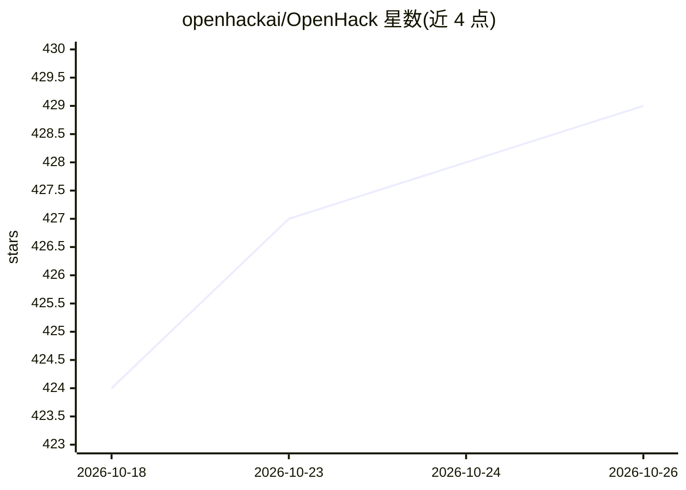

# openhackai/OpenHack

⭐ 429 · Python · MIT · 推送 2026-10-17 · [GitHub](https://github.com/openhackai/OpenHack) · [官网](https://openhack.com) · 组织维护

**开源 Agentic 安全扫描器：用多 Agent 流水线检测并验证代码漏洞**

面向代码库的多 Agent 安全扫描 CLI/TUI：流水线分 Recon（构建项目模型）→ Hunters（多类专用漏洞猎手）→ Validation（复核候选发现）→ Verification（Docker 沙箱 + 无头浏览器实测利用验证）。输出严重度、CVSS、代码位置、漏洞片段与修复建议；支持无头 CI 模式输出 JSON 报告、断点续扫、多 provider 接入（含 BYOK），源码本地处理但提示发送至所选模型服务。沙箱/浏览器验证为 Beta 功能且要求 Docker。

## 筛选速览

| 维度 | 判定 | 备注 |
|---|---|---|
| AI 角色 | `ai-native` | 本体是模型或模型工具 |
| 许可风险 | `permissive` | MIT |
| 部署形态 | `library` | 以包/库形式分发 |
| 模型依赖 | locked-api |  |
| 硬件要求 | — | 无带数字的原话,不猜 |
| 安装摩擦 | `low` | 无编译、无系统依赖或容器化 |
| 成熟度 | `idea` | |

## 能力要点

- recon→hunting→validation→verification 四阶段多 Agent 流水线
- Docker 沙箱 + 无头浏览器实测验证漏洞（Beta，需 Docker）
- TUI 交互与无头 CLI 模式（JSON 报告、断点续扫）
- 多 provider 接入：OpenHack 托管、BYOK、OpenAI 订阅、Azure、Bedrock 等

## 适用场景

- 开发者在提交前扫描代码库查找已验证的漏洞
- CI 流水线中无头运行安全扫描并输出 JSON 报告
- 对 XSS/SQL 注入等类别做沙箱实测验证

## 场景标签

`多智能体` `网络安全` · 领域:Agent 开发

## 证据(README 行号)

> L36: OpenHack does `recon` -> `hunting` -> `validation` -> `verification` all in one pipeline to find high quality verif
> L60: OpenHack runs a multi-agent pipeline against your codebase:

## 星数曲线

2026-10-18 424 → 2026-10-26 429（+5）

---
*卡片 v1 · prompt 1.4 · 生成 2026-10-21 · 置信度 high · 依据 README sha `2c00fef6942b` · [字段定义](../../DATASET.md)*
