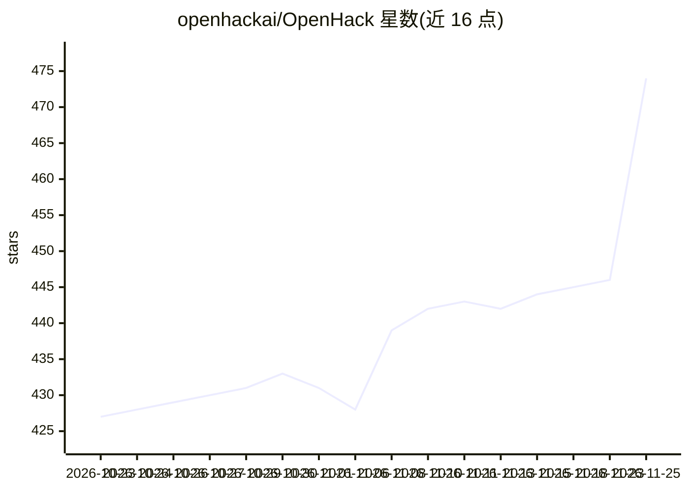

# openhackai/OpenHack

⭐ 474 · TypeScript · AGPL-3.0 · 推送 2026-11-23 · [GitHub](https://github.com/openhackai/OpenHack) · [官网](https://openhack.com) · 组织维护

**本地 AI 代码安全扫描器：用 LLM 审查源码并输出发现**

以本地 CLI 与浏览器仪表盘形式提供的源代码安全扫描工具：扫描前映射代码库、分配聚焦的源码审查、对候选发现做质疑与证据判定，发现含源码证据、验证状态与修复建议。数据（扫描历史、发现、配置）保存在本地工作区，仅监听 loopback。扫描必须接入 AI 提供商（API key 或 Codex/Claude Code 订阅登录），源码摘录发送至远程提供商，非离线推理。读取代码但不执行、不自动改码。macOS/Linux 提供独立可执行文件，内置 Bun 运行时；另有面向企业的 Pro 版本提供业务影响评估与 Slack 集成。

## 筛选速览

| 维度 | 判定 | 备注 |
|---|---|---|
| AI 角色 | `ai-native` | 本体是模型或模型工具 |
| 许可风险 | `viral` | AGPL-3.0 |
| 部署形态 | `desktop` | 安装包/桌面程序 |
| 模型依赖 | locked-api |  |
| 硬件要求 | — | 无带数字的原话,不猜 |
| 安装摩擦 | `low` | 无编译、无系统依赖或容器化 |
| 成熟度 | — | 结构信号不足 |

## 能力要点

- v2 流程：代码库映射、聚焦审查、候选发现质疑与证据判定
- 支持 OpenAI/Anthropic API key 及 Codex、Claude Code 订阅登录接入
- 仪表盘与终端双入口，扫描可检查点保存并恢复
- 源码收集遵守 .gitignore/.openhackignore，密钥本地明文存储且有权限控制

## 适用场景

- 扫描本地项目源码获取带证据的安全发现
- CI/流水线中以 --fail-on 退出码阻断含未决发现的构建
- 企业在仪表盘中对发现做打开/解决/忽略的分诊管理

## 场景标签

`代码审查` `网络安全` · 领域:编码与开发

## 证据(README 行号)

> L3: OpenHack is a local AI security scanner for source code. Pick a project, connect your AI provider, and review findin
> L7: The v2 harness maps your codebase, assigns focused source reviews, challenges candidate findings, and judges the evi
> L147: Project code is read, not executed. Required source excerpts and paths are sent to your chosen remote AI provider;

## 星数曲线

2026-10-23 427 → 2026-11-25 474（+47）

---
*卡片 v1 · prompt 1.4 · 生成 2026-11-25 · 置信度 high · 依据 README sha `1de7f8360844` · [字段定义](../../DATASET.md)*
