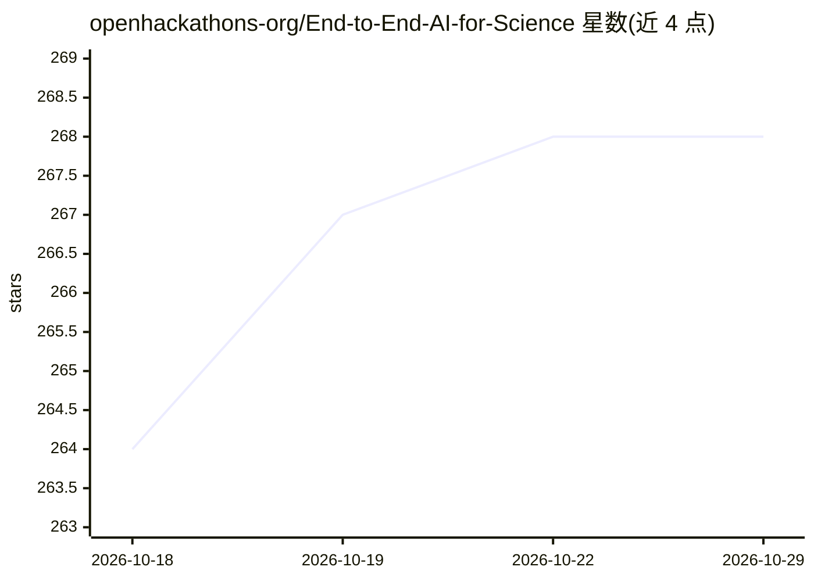

# openhackathons-org/End-to-End-AI-for-Science

⭐ 268 · Jupyter Notebook · Apache-2.0 · 推送 2026-09-24 · [GitHub](https://github.com/openhackathons-org/End-to-End-AI-for-Science) · 组织维护

**面向科研人员的端到端 AI for Science 训练营教材（NVIDIA PhysicsNeMo）**

OpenHackathons 发布的 Bootcamp 教材仓库：以 NVIDIA PhysicsNeMo 框架为主线，覆盖物理驱动（PINN、Navier-Stokes）与数据驱动（FNO/AFNO、FourCastNet）两大路线，包含天气预报、Darcy 流、外空气动力学（DoMINO）、大规模 CFD（Transolver/GeoTransolver 六个 Notebook 含理论推导、训练与不确定性量化）等 5 个模块的动手实验，并引入 Earth2Studio 做天气模型推理、ParaView 做仿真可视化。要求微分方程、Python 与深度学习基础，总时长约 14 小时，材料以 CC BY 4.0 发布，部署方式另见指南。

## 筛选速览

| 维度 | 判定 | 备注 |
|---|---|---|
| AI 角色 | `ai-knowledge` | 知识聚合/清单类 |
| 许可风险 | `permissive` | Apache-2.0 |
| 部署形态 | `None` |  |
| 模型依赖 | — | README 未给出锁定关系 |
| 硬件要求 | — | 无带数字的原话,不猜 |
| 安装摩擦 | `low` | 无编译、无系统依赖或容器化 |
| 成熟度 | — | 结构信号不足 |

## 能力要点

- 5 个模块覆盖 PINN、神经算子（FNO/AFNO/FourCastNet）与外空气动力学（DoMINO）
- GeoTransolver 六个 Notebook：从 Transformer 复杂度推导到训练与 MC-Dropout 不确定性量化
- 使用 NVIDIA PhysicsNeMo、Earth2Studio 与 ParaView 工具链
- 包含 GTC 2025/2026 Earth-2 工作坊内容

## 适用场景

- 系统学习物理信息神经网络与神经算子方法
- 上手 PhysicsNeMo 训练物理 ML 模型与 AI 天气模型
- 学习大规模 CFD 的 Physics-Attention 与 GeoTransolver 实现

## 场景标签

`教程课程` · 领域:学习与行业

## 证据(README 行号)

> L3: This Bootcamp will provide researchers hands-on approaches on how to use NVIDIA PhysicsNeMo, a framework that combin
> L7: The content is structured in multiple modules covering the following:

## 星数曲线

2026-10-18 264 → 2026-10-29 268（+4）

---
*卡片 v1 · prompt 1.4 · 生成 2026-10-22 · 置信度 high · 依据 README sha `cf9d88a3e90e` · [字段定义](../../DATASET.md)*
