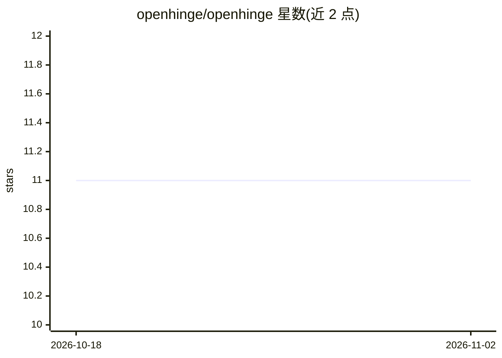

# openhinge/openhinge

⭐ 11 · TypeScript · MIT · 推送 2026-04-20 · [GitHub](https://github.com/openhinge/openhinge) · 组织维护

**自托管 AI 网关：统一多家 LLM 为单一 OpenAI 兼容 API**

自托管 LLM 网关服务：将 Claude、OpenAI、Gemini、Ollama 聚合到统一的 OpenAI 与 Anthropic 兼容 API 之后，支持用自有订阅（OAuth 登录）或 API key 接入，可挂多个同类账号并自动降级切换。提供 AI 人格（souls，绑定系统提示与专属端点）、ohk_ 前缀 API key 的限流/预算/绑定控制、请求日志与 Web 管理面板、CLI 与自更新。内嵌 SQLite，无需 Redis/Postgres/Docker；通过 install.sh 脚本或 git clone + npm 构建运行。

## 筛选速览

| 维度 | 判定 | 备注 |
|---|---|---|
| AI 角色 | `ai-ecosystem` | LLM/agent 周边工具 |
| 许可风险 | `permissive` | MIT |
| 部署形态 | `library` | 以包/库形式分发 |
| 模型依赖 | local-ok | 支持本地模型 |
| 硬件要求 | — | 无带数字的原话,不猜 |
| 安装摩擦 | `low` | 无编译、无系统依赖或容器化 |
| 成熟度 | — | 结构信号不足 |

## 能力要点

- 多供应商聚合，双 API 格式（OpenAI /v1/chat/completions 与 Anthropic /v1/messages）
- OAuth 订阅接入，token 每 15 分钟自动刷新，支持多账号自动降级
- souls 人格端点 + API key 限流、soul 绑定、预算与过期控制
- 内嵌 SQLite 零外部依赖，含 Web 面板、CLI、自更新与自愈重建

## 适用场景

- 把自有 Claude/ChatGPT/Gemini 订阅变成团队统一 API 使用
- 为不同用途配置带系统提示的专属模型端点
- 对下游请求做 key 分发、限流与用量/成本审计

## 场景标签

`模型网关` · 领域:Agent 开发

## 证据(README 行号)

> L3: Self-hosted AI gateway that unifies multiple LLM providers behind a single OpenAI-compatible API.
> L9: - **Multi-provider** — Claude, OpenAI, Gemini, Ollama. Multiple accounts of the same type supported.

## 星数曲线

2026-10-18 11 → 2026-11-02 11（+0）

---
*卡片 v1 · prompt 1.4 · 生成 2026-11-01 · 置信度 high · 依据 README sha `2565f0ba31cd` · [字段定义](../../DATASET.md)*
