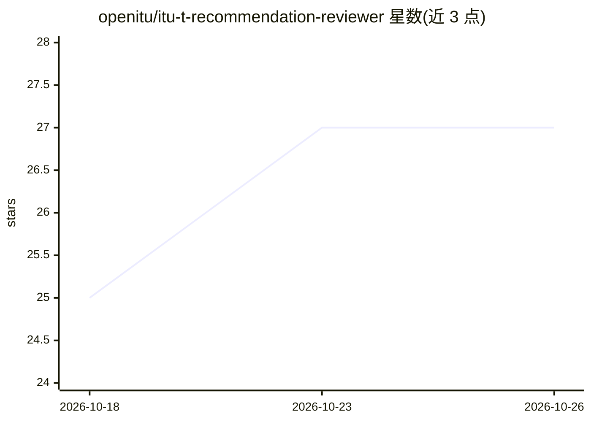

# openitu/itu-t-recommendation-reviewer

⭐ 27 · MIT · 推送 2026-09-03 · [GitHub](https://github.com/openitu/itu-t-recommendation-reviewer) · 组织维护 · 中文 README

**审查 ITU-T 建议书草案是否符合编辑规则的 AI 技能**

以纯 Markdown 编写的开放式 Agent Skills（SKILL.md + 5 个参考文件），供任意 LLM 或 agent 框架加载后执行：先分类文档类型（纯 ITU-T / ITU-T|ISO/IEC 共同文本 / 修正案），再按六个维度（骨架与必备要素、样板措辞、引用、定义与缩略语、图表公式、质量清单与语言）逐轮审查，输出带 READY/MINOR/MAJOR 总判定、按条款定位并引用规则依据的结构化报告，另附 Annex D 预批准清单。不判断技术内容正确性，不预测批准结果。使用可免下载：让有网页抓取能力的模型直接读取 GitHub 上的文件，或克隆到 agent 技能目录 / 在 Claude 应用中导入 .skill 文件。

## 筛选速览

| 维度 | 判定 | 备注 |
|---|---|---|
| AI 角色 | `ai-native` | 本体是模型或模型工具 |
| 许可风险 | `permissive` | MIT |
| 部署形态 | `None` |  |
| 模型依赖 | — | README 未给出锁定关系 |
| 硬件要求 | — | 无带数字的原话,不猜 |
| 安装摩擦 | `low` | 无编译、无系统依赖或容器化 |
| 成熟度 | — | 结构信号不足 |

## 能力要点

- 编码 ITU-T Author's Guide、共同文本呈现规则、A.1 及 TSAG 草案清单四套规则源
- 六轮审查流程输出结构化报告（总判定 + Critical/Major/Minor 分级发现）
- 模型无关：纯 Markdown，任意 LLM/agent 框架均可加载
- 支持网页抓取免安装用法，报告以工作语言交付

## 适用场景

- 提交 TSB 或送交同意/批准前检查建议书草案的编辑合规性
- 让 AI 按官方规则定位草案中的定义、引用、图表等格式问题并给出修改建议
- 多语言团队用中文等 working language 获得符合 ITU-T 规则的审查报告

## 场景标签

 · 领域:标准化/文档合规审查

## 证据(README 行号)

> L3: A **model-agnostic AI agent skill** that reviews draft **ITU-T Recommendations** (including ITU-T | ISO/IEC common t
> L20: 1. **Classify the document type first** — pure ITU-T text, ITU-T | ISO/IEC common text, or amendment/corrigendum — 
> L22: 3. **Produce a structured review report** with an overall verdict (READY / MINOR REVISION / MAJOR REVISION), findin

## 星数曲线

2026-10-18 25 → 2026-10-26 27（+2）

---
*卡片 v1 · prompt 1.4 · 生成 2026-10-26 · 置信度 high · 依据 README sha `6ddc0f7162b0` · [字段定义](../../DATASET.md)*
