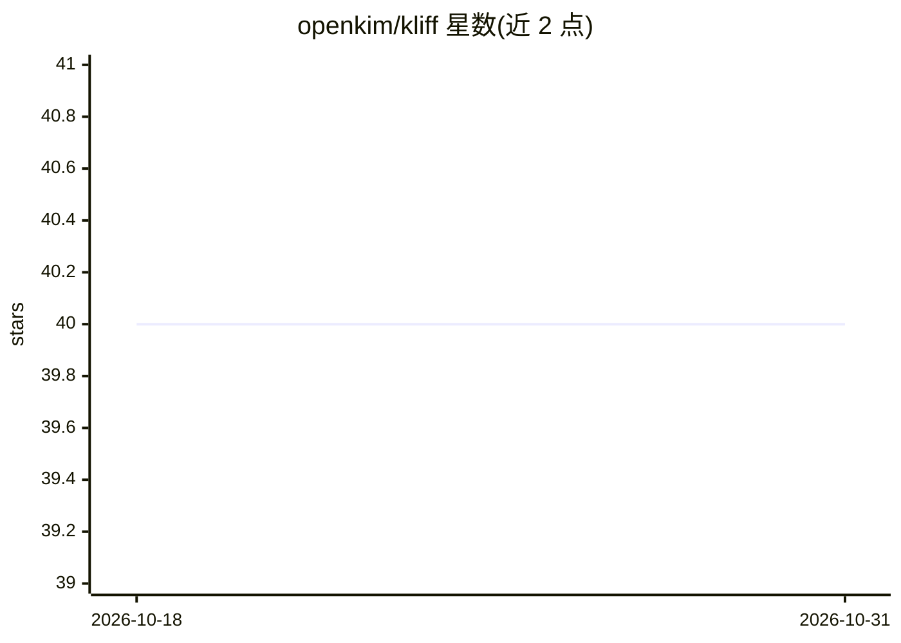

# openkim/kliff

⭐ 40 · Python · LGPL-2.1 · 推送 2026-10-29 · [GitHub](https://github.com/openkim/kliff) · [官网](https://kliff.readthedocs.io) · 组织维护

**面向材料模拟的原子间势拟合框架（物理势与神经网络势）**

KLIFF 是基于 KIM 的原子间势拟合软件包，可拟合物理动机（PM）势与神经网络（NN）等机器学习势。提供高层 API（几行代码完成拟合）与低层 API（构建复杂 NN 模型），NN 训练采用 PyTorch 后端并支持 GPU 与并行执行；训练好的模型可经 KIM API 用于 LAMMPS、ASE 等模拟代码，也可通过 TorchScript 部署，还支持 PM 与 NN 混合建模。依赖 kim-api 与 kimpy（conda 安装时自动处理）。面向材料模拟与分子动力学领域的研究者和开发者。需引用 2022 年发表论文。

## 筛选速览

| 维度 | 判定 | 备注 |
|---|---|---|
| AI 角色 | `ai-native` | 本体是模型或模型工具 |
| 许可风险 | `viral` | LGPL-2.1 |
| 部署形态 | `library` | 以包/库形式分发 |
| 模型依赖 | — | README 未给出锁定关系 |
| 硬件要求 | — | 无带数字的原话,不猜 |
| 安装摩擦 | `low` | 无编译、无系统依赖或容器化 |
| 成熟度 | — | 结构信号不足 |

## 能力要点

- 拟合物理动机势与神经网络机器学习势，支持混合 PM+NN 模型
- 高层/低层双层 API，PyTorch 后端含 GPU 训练与并行执行
- 拟合模型经 KIM API 直接用于 LAMMPS、ASE 等模拟代码
- TorchScript 与 KIM-API 部署训练好的 ML 模型

## 适用场景

- 为分子动力学模拟训练神经网络原子间势
- 在 LAMMPS/ASE 中复用拟合出的 KIM 模型
- 构建物理动机与机器学习混合的势函数模型

## 场景标签

`模型训练` · 领域:训练与推理

## 证据(README 行号)

> L10: KLIFF is an interatomic potential fitting package that can be used to fit
> L11: physics-motivated (PM) potentials, as well as machine learning potentials such

## 星数曲线

2026-10-18 40 → 2026-10-31 40（+0）

---
*卡片 v1 · prompt 1.4 · 生成 2026-10-25 · 置信度 high · 依据 README sha `8fdcadaed8ea` · [字段定义](../../DATASET.md)*
