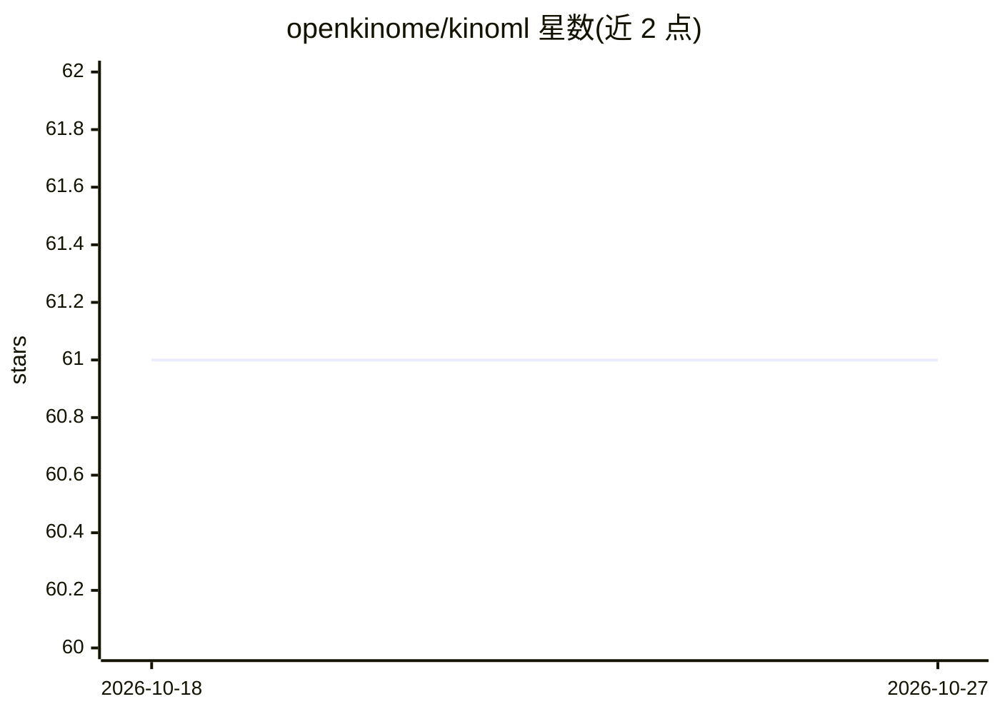

# openkinome/kinoml

⭐ 61 · Jupyter Notebook · MIT · 推送 2026-10-26 · [GitHub](https://github.com/openkinome/kinoml) · [官网](https://openkinome.org/kinoml/) · 组织维护

**面向激酶的药物发现机器学习框架，覆盖数据到模型全流程**

用于小分子药物发现中机器学习实验的模块化框架，聚焦激酶但可用于任意蛋白体系。功能分三步：从 ChEMBL/PubChem 或本地文件获取数据、提供从配体单独到配体:激酶复合物的多种特征化方案、运行结构_based 模型实验并评估，强调可复现性。提供教程与端到端实验示例（配体结合亲和力预测）。以 Docker 镜像和 conda/mamba 两种方式安装；部分教程需要 OpenEye 或 Schrodinger 商业许可证。README 声明代码为进行中工作，API 可能随时变动。

## 筛选速览

| 维度 | 判定 | 备注 |
|---|---|---|
| AI 角色 | `ai-ecosystem` | LLM/agent 周边工具 |
| 许可风险 | `permissive` | MIT |
| 部署形态 | `self-host` | docker 或自建部署 |
| 模型依赖 | — | README 未给出锁定关系 |
| 硬件要求 | — | 无带数字的原话,不猜 |
| 安装摩擦 | `low` | 无编译、无系统依赖或容器化 |
| 成熟度 | `idea` | |

## 能力要点

- 从 ChEMBL/PubChem 及本地文件获取数据，关注数据可得性与不变性
- 多种特征化方案：从配体单独到配体:激酶复合物
- 内置模型用于配体结合亲和力预测的结构_based 实验
- 提供入门教程与四个端到端实验示例

## 适用场景

- 我在做激酶相关的药物发现 ML 实验，需要从数据到评估的完整工作流
- 我想用配体:激酶复合物特征化方案训练结合亲和力预测模型
- 我想复现结构_based 的激酶 ML 实验流程

## 场景标签

 · 领域:计算药物发现/结构生物学

## 证据(README 行号)

> L12: **KinoML** is a modular and extensible framework for machine learning (ML) in small molecule drug discovery with a 
> L17: The purpose of KinoML is to help users conduct ML kinase experiments, from data collection to model evaluation. Tut

## 星数曲线

2026-10-18 61 → 2026-10-27 61（+0）

---
*卡片 v1 · prompt 1.4 · 生成 2026-10-24 · 置信度 high · 依据 README sha `ff7c4fd8e882` · [字段定义](../../DATASET.md)*
