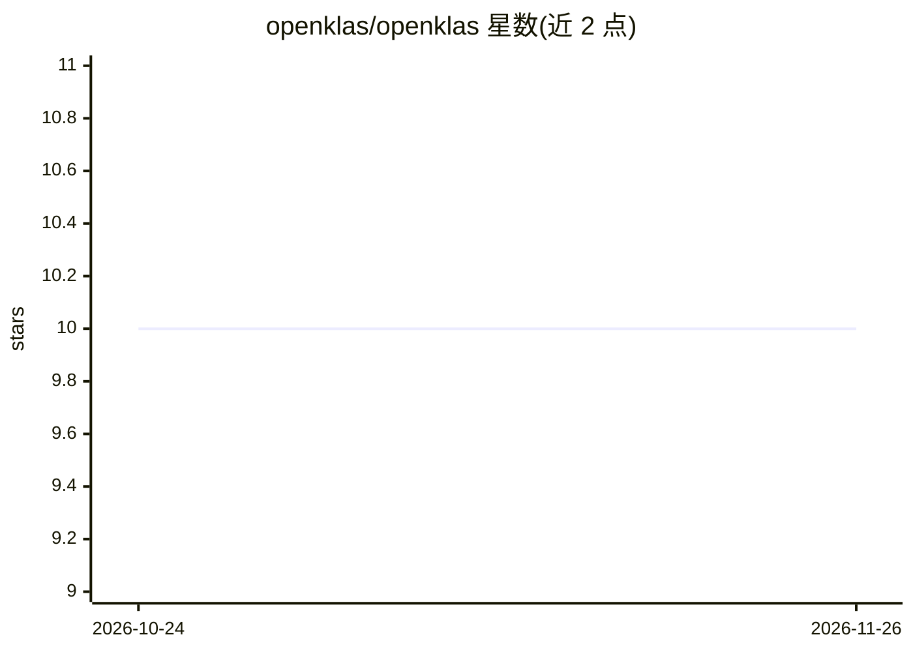

# openklas/openklas

⭐ 10 · Python · 推送 2026-06-27 · [GitHub](https://github.com/openklas/openklas) · [官网](https://openklas.com) · 组织维护

**给光云大学学生的 KLAS 学习系统 MCP 服务，接入 AI 助手**

以 FastAPI 封装光云大学学习管理系统（KLAS）的开源后端，将其暴露为 REST API，并通过 fastapi-mcp 使每个端点成为 Claude 工具；用户在 Claude.ai 添加自定义连接器即可用自然语言查询课程数据。内置 RSA 加密登录与双令牌认证；提供录播课下载→Whisper 转写→Claude 摘要→存入 Obsidian 的流水线，以及基于 Voyage AI 嵌入、pgvector 和 Ollama 的课程 PDF 问答。宿主为 Kwangwoon University 的 KLAS，README 未给出本地安装命令。

## 筛选速览

| 维度 | 判定 | 备注 |
|---|---|---|
| AI 角色 | `ai-native` | 本体是模型或模型工具 |
| 许可风险 | `none` | — |
| 部署形态 | `None` |  |
| 模型依赖 | local-ok | 支持本地模型 |
| 硬件要求 | — | 无带数字的原话,不猜 |
| 安装摩擦 | `low` | 无编译、无系统依赖或容器化 |
| 成熟度 | — | 结构信号不足 |

## 能力要点

- 每个端点经 fastapi-mcp 暴露为 Claude 工具，支持 Claude.ai 自定义连接器接入
- RSA 加密登录与 session token + JWT 双令牌认证
- 录播课流水线：下载→Whisper 转写→Claude 摘要→保存至 Obsidian
- 课程 PDF 问答：Voyage AI 嵌入 + pgvector + Ollama，按用户隔离

## 适用场景

- 用自然语言查询各科剩余录播课时与作业截止日期
- 让 AI 汇总一小时录播课生成学习笔记
- 向课程 PDF 提问获取基于讲义的回答
- 让 AI 起草给教授的韩语延期提交邮件

## 场景标签

`AI 助手` `RAG` `文档问答` · 领域:对话与助手

## 证据(README 行号)

> L3: An open-source FastAPI backend that wraps KLAS — Kwangwoon University's Learning Management System — and exposes it 
> L13: - **MCP Server** — every endpoint is a Claude tool via `fastapi-mcp`; connect to Claude.ai as a custom OAuth connec
> L17: - **RAG** — ingest lecture PDFs, query them with Voyage AI embeddings + pgvector + Ollama

## 星数曲线

2026-10-24 10 → 2026-11-26 10（+0）

---
*卡片 v1 · prompt 1.4 · 生成 2026-11-19 · 置信度 high · 依据 README sha `6bd5df14aea2` · [字段定义](../../DATASET.md)*
