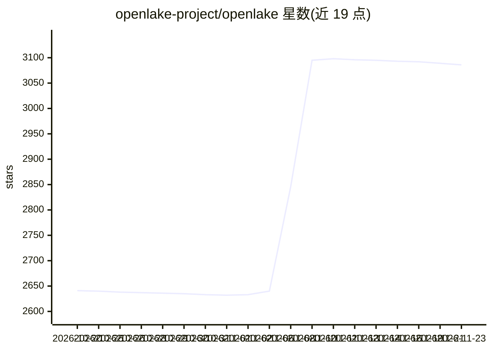

# openlake-project/openlake

⭐ 3,086 · Rust · Apache-2.0 · 推送 2026-11-19 · [GitHub](https://github.com/openlake-project/openlake) · 组织维护

**面向 LLM 推理与 GPU 训练的分布式存储引擎**

基于 Rust 与 Linux io_uring 的分布式存储引擎，为 AI 基础设施提供高吞吐小 I/O 与持久化缓存能力。核心机制包括 GPUDirect Storage 与 RDMA 零拷贝路径、每核 pinned compio 异步运行时、信用流控的 PacedRDMA，以及 SIMD Reed Solomon 纠删码。提供 KV Cache Offload、S3 兼容对象存储、checkpoint 存取等功能。通过 pip 安装 vLLM 连接器，或以 cargo 从源码构建；README 声明 Apache 2.0 许可。

## 筛选速览

| 维度 | 判定 | 备注 |
|---|---|---|
| AI 角色 | `ai-ecosystem` | LLM/agent 周边工具 |
| 许可风险 | `permissive` | Apache-2.0 |
| 部署形态 | `library` | 以包/库形式分发 |
| 模型依赖 | local-ok | 支持本地模型 |
| 硬件要求 | — | 无带数字的原话,不猜 |
| 安装摩擦 | `medium` | 含编译或系统依赖之一 |
| 成熟度 | — | 结构信号不足 |

## 能力要点

- KV Cache Offload：GPU 主机上共置的 PB 级 KV cache 存储
- GPUDirect Storage 与 RDMA 实现存储到 GPU 显存的零拷贝传输
- S3 兼容对象存储，可用任意 S3 客户端访问
- 提供 vLLM KV 连接器，无需代码改动接入

## 适用场景

- 为 vLLM 推理集群卸载与共享 KV cache
- RL/ML 训练任务的快速 checkpoint 存取
- GPU 集群上的 PB 级对象存储
- Agent 场景下大规模对话与上下文的快速检索

## 场景标签

 · 领域:AI 基础设施/存储

## 证据(README 行号)

> L23: 🔥 Distributed storage for GPU workloads. Built on Rust on `io_uring`, OpenLake is a state of the art storage engine
> L37: OpenLake is a storage engine for AI infrastructure. With OpenLake you get high throughput for small I/O and cache l
> L70: vllm serve <model_name> --kv-transfer-config '{"kv_connector":"OpenLakeConnector","kv_connector_module_path":"openl

## 星数曲线

2026-10-20 2,641 → 2026-11-23 3,086（+445）

---
*卡片 v1 · prompt 1.4 · 生成 2026-11-23 · 置信度 high · 依据 README sha `7147440cf25d` · [字段定义](../../DATASET.md)*
