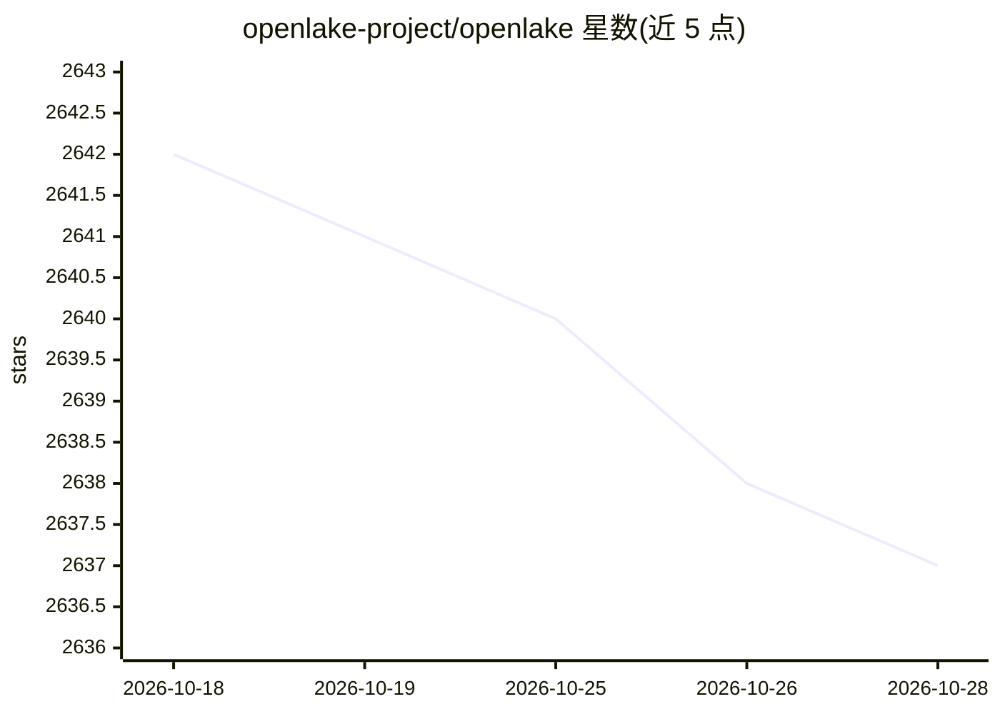

# openlake-project/openlake

⭐ 2,637 · Rust · Apache-2.0 · 推送 2026-10-24 · [GitHub](https://github.com/openlake-project/openlake) · 组织维护

**面向 LLM 推理与 GPU 训练的高吞吐分布式存储引擎**

用 Rust 编写的 AI 基础设施存储引擎，基于 Linux io_uring 与 RDMA/GPUDirect Storage 提供低延迟、可持久化的存储层。能力包括 PB 级 KV Cache 卸载（配合 vLLM 的专用 connector，免改代码）、向量库索引与服务、RL/ML 检查点高速存取、小文件训练 I/O 与 agentic 上下文存储，另提供 S3 兼容的 PB 级对象存储。安装途径为 pip 安装 vLLM connector 或从源码 cargo 构建；构建需安装 cmake、clang、libhwloc 等系统依赖，支持 Ubuntu、macOS（开发）与 Windows WSL2。Apache 2.0 许可，由 openlake-project 团队维护。

## 筛选速览

| 维度 | 判定 | 备注 |
|---|---|---|
| AI 角色 | `ai-ecosystem` | LLM/agent 周边工具 |
| 许可风险 | `permissive` | Apache-2.0 |
| 部署形态 | `library` | 以包/库形式分发 |
| 模型依赖 | local-ok | 支持本地模型 |
| 硬件要求 | — | 无带数字的原话,不猜 |
| 安装摩擦 | `medium` | 含编译或系统依赖之一 |
| 成熟度 | — | 结构信号不足 |

## 能力要点

- 基于 io_uring 与 compio 的 per-core 异步 I/O，GPUDirect Storage/RDMA 零拷贝到 GPU 显存
- vLLM 专用 KV connector，跨 GPU 节点共享 KV 前缀池
- S3 兼容对象存储，SIMD Reed-Solomon 纠删码提供持久性
- PacedRDMA 信用流控应对突发请求

## 适用场景

- 长上下文 LLM 推理的 KV Cache 卸载以降低成本、加速首 token
- GPU 集群上高速保存与恢复训练/RL 检查点
- 构建 PB 级 S3 兼容对象存储服务 GPU 训练数据
- 为 agentic 应用存储大规模对话与上下文供快速检索

## 场景标签

`向量数据库` · 领域:知识与检索

## 证据(README 行号)

> L12: 🔥 Distributed storage for GPU workloads. Built on Rust on `io_uring`, OpenLake is a state of the art storage engine
> L26: OpenLake is a storage engine for AI infrastructure. With OpenLake you get high throughput for small I/O and cache l

## 星数曲线

2026-10-18 2,642 → 2026-10-28 2,637（-5）

---
*卡片 v1 · prompt 1.4 · 生成 2026-10-21 · 置信度 high · 依据 README sha `8ea525a4b5a6` · [字段定义](../../DATASET.md)*
