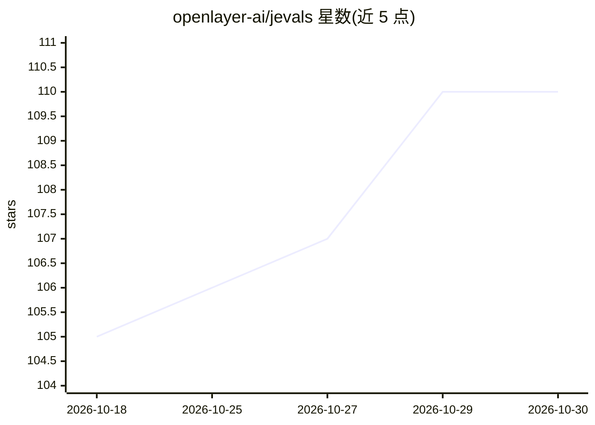

# openlayer-ai/jevals

⭐ 110 · Python · MIT · 推送 2026-10-15 · [GitHub](https://github.com/openlayer-ai/jevals) · [官网](https://github.com/openlayer-ai/jevals) · 组织维护

**面向 agent 轨迹的评测与护栏库，单请求低成本运行**

Python 评测库（pip 安装），提供 agent 评测（工具选择、结果使用、Grounded、越界检测）与质量评测（相关性、完整性），同一评测定义可作离线指标、生产监控或 agent 内护栏。核心机制是用 Jev 风格决策模型替代 LLM judge：一个 trace 的所有问题打包为一次请求返回校准概率。支持多后端：TypeSafe/Vercel 网关的 Jev、OpenRouter 决策模型、本地运行的 Kev/Laya/Eikos、或用普通 chat LLM 模拟（更慢更贵）。限制：换后端需重新 calibrate；本地后端需 Mac 或 GPU。

## 筛选速览

| 维度 | 判定 | 备注 |
|---|---|---|
| AI 角色 | `ai-ecosystem` | LLM/agent 周边工具 |
| 许可风险 | `permissive` | MIT |
| 部署形态 | `library` | 以包/库形式分发 |
| 模型依赖 | — | README 未给出锁定关系 |
| 硬件要求 | — | 无带数字的原话,不猜 |
| 安装摩擦 | `low` | 无编译、无系统依赖或容器化 |
| 成熟度 | — | 结构信号不足 |

## 能力要点

- 单 trace 所有 eval 合并为一次 HTTP 请求，延迟与问题数量基本无关
- 多后端解析：Jev API、OpenRouter、本地 Kev/Laya/Eikos、chat LLM 模拟，可显式指定并切换
- 同一 Eval 类可复用为离线指标、生产监控与 agent 内护栏
- 提供 CLI（jevals run/bench/calibrate）与 MCP server、OpenAI Agents/LangGraph/Claude 集成可选包

## 适用场景

- 对 agent 轨迹做离线评测，检查工具调用与是否编造
- 在生产请求路径上对每条 trace 运行护栏
- 与 Ragas 对比跑 RAG 四指标并输出成本与耗时报告

## 场景标签

`模型评测` · 领域:评测与运维

## 证据(README 行号)

> L3: Evals and guardrails for agents, using Jev-style decision models instead of an LLM judge. All the evals for a trace 
> L25: Ragas is where most of us got our metric names, and its source shows where an LLM judge spends its money. Faithfuln

## 星数曲线

2026-10-18 105 → 2026-10-30 110（+5）

---
*卡片 v1 · prompt 1.4 · 生成 2026-10-23 · 置信度 high · 依据 README sha `bd0ff518f8d9` · [字段定义](../../DATASET.md)*
