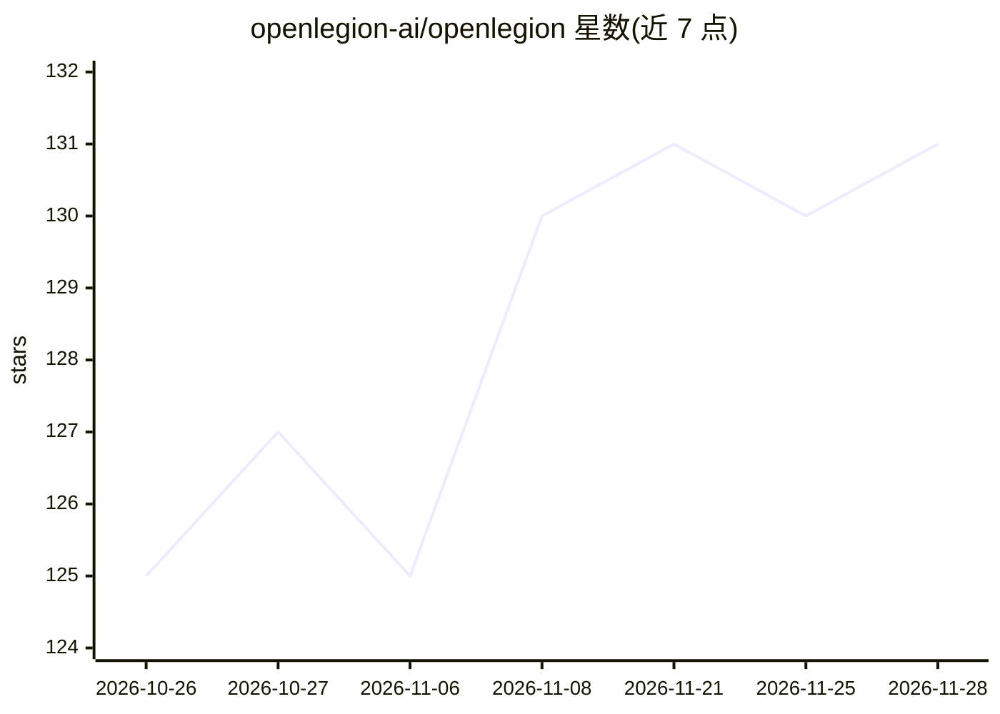

# openlegion-ai/openlegion

⭐ 131 · Python · NOASSERTION · 推送 2026-11-03 · [GitHub](https://github.com/openlegion-ai/openlegion) · [官网](https://openlegion.ai) · 组织维护

**面向团队的自托管安全多智能体运行时**

OpenLegion 是自托管的自主 AI 智能体运行时：每个智能体运行在独立的 Docker 容器（或 microVM）中，API 密钥集中存放在凭据库、智能体不直接接触密钥，并按智能体执行每日/每月预算上限；通过 blackboard 共享状态与 pub/sub 事件协调多智能体，支持 Telegram、Discord、Slack、WhatsApp 与 CLI 接入，经 LiteLLM 支持 100+ LLM 提供商并提供故障转移。许可证为 PolyForm Perimeter 1.0.1，可免费自托管含商业内部使用，但不得将其转售为与 OpenLegion 竞争的托管服务；官方另提供付费托管版。

## 筛选速览

| 维度 | 判定 | 备注 |
|---|---|---|
| AI 角色 | `ai-ecosystem` | LLM/agent 周边工具 |
| 许可风险 | `none` | NOASSERTION |
| 部署形态 | `self-host` | docker 或自建部署 |
| 模型依赖 | local-ok | 支持本地模型 |
| 硬件要求 | — | 无带数字的原话,不猜 |
| 安装摩擦 | `low` | 无编译、无系统依赖或容器化 |
| 成熟度 | — | 结构信号不足 |

## 能力要点

- 每个智能体独立 Docker 容器隔离，密钥经凭据库代理、智能体不接触密钥
- 按智能体的 LLM 成本追踪与每日/每月预算强制上限
- 经 LiteLLM 支持 100+ LLM 提供商，含健康跟踪的故障转移链
- cron、心跳与 webhook 触发的自主运行，多渠道消息接入

## 适用场景

- 在自己基础设施上运行需要隔离与审计的生产级智能体集群
- 为多智能体系统设置按智能体的费用与权限控制
- 通过 Telegram/Discord/Slack/WhatsApp 与智能体队伍交互

## 场景标签

`Agent 框架` `多智能体` · 领域:Agent 开发

## 证据(README 行号)

> L35: OpenLegion is a **secure, self-hosted AI agent runtime** for running fleets of autonomous AI agents in production. 
> L121: OpenLegion is an **autonomous AI agent framework** for running multi-agent
> L19: > A source-available, security-first OpenClaw alternative for teams. Chat via Telegram, Discord, Slack, or WhatsApp

## 星数曲线

2026-10-26 125 → 2026-11-28 131（+6）

---
*卡片 v1 · prompt 1.4 · 生成 2026-11-28 · 置信度 mid · 依据 README sha `56213985f8f2` · [字段定义](../../DATASET.md)*
