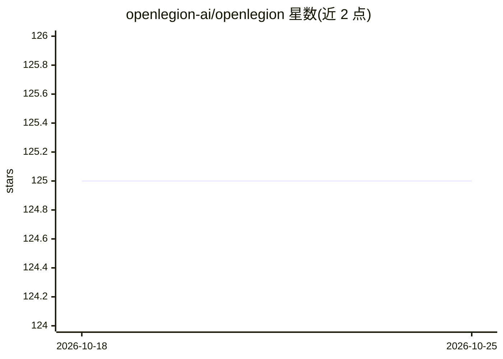

# openlegion-ai/openlegion

⭐ 125 · Python · NOASSERTION · 推送 2026-08-23 · [GitHub](https://github.com/openlegion-ai/openlegion) · [官网](https://openlegion.ai) · 组织维护

**自托管安全多智能体运行时：隔离容器跑自主 agent 团队**

面向生产环境的多智能体框架：每个 agent 运行在独立的加固 Docker 容器或 microVM 中，拥有独立记忆、工具、调度与预算；API 密钥保存在中央凭据库，agent 经代理调用，vault 层强制按 agent 设置日/月预算上限。可信 mesh host 通过黑板共享状态与 pub/sub 协调，跨 agent 操作需 ACL 检查，无 LLM 路由层。支持 100+ LLM 提供商（LiteLLM）与健康跟踪故障转移，可经 Telegram/Discord/Slack/WhatsApp/CLI 对话。源码可用（PolyForm Perimeter 1.0.1），禁止将其作为竞争性产品转售；另有 OpenLegion LLC 提供托管服务。

## 筛选速览

| 维度 | 判定 | 备注 |
|---|---|---|
| AI 角色 | `ai-ecosystem` | LLM/agent 周边工具 |
| 许可风险 | `none` | NOASSERTION |
| 部署形态 | `self-host` | docker 或自建部署 |
| 模型依赖 | local-ok | 支持本地模型 |
| 硬件要求 | — | 无带数字的原话,不猜 |
| 安装摩擦 | `low` | 无编译、无系统依赖或容器化 |
| 成熟度 | — | 结构信号不足 |

## 能力要点

- 每 agent 独立 Docker 容器/microVM 隔离，凭据库代理调用，agent 不持有密钥
- vault 层强制按 agent 的日/月预算上限与实时成本跟踪
- 黑板共享状态 + pub/sub 协调多 agent，无 LLM 路由层
- agent 可运行时自写 Python 工具热加载、派生子 agent，cron/webhook/心跳触发

## 适用场景

- 在生产环境运行常驻、共享的多 agent 团队并控制成本
- 自托管运行 agent 团队，凭据与数据不出自有基础设施
- 经 Telegram/Discord/Slack/WhatsApp 多渠道与 agent 团队对话
- 需要容器隔离与审计的不可信输入处理场景

## 场景标签

`Agent 框架` `多智能体` · 领域:Agent 开发

## 证据(README 行号)

> L31: OpenLegion is a **secure, self-hosted AI agent runtime** for running fleets of autonomous AI agents in production. 
> L117: OpenLegion is an **autonomous AI agent framework** for running multi-agent

## 星数曲线

2026-10-18 125 → 2026-10-25 125（+0）

---
*卡片 v1 · prompt 1.4 · 生成 2026-10-23 · 置信度 mid · 依据 README sha `e5598edb0a06` · [字段定义](../../DATASET.md)*
