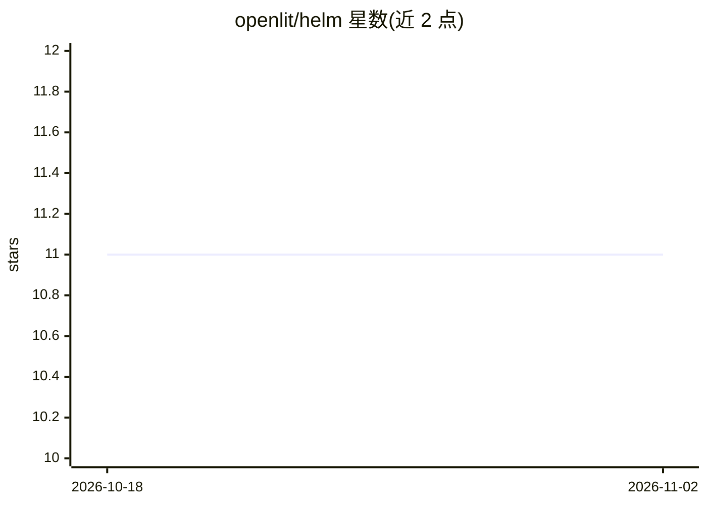

# openlit/helm

⭐ 11 · Go Template · Apache-2.0 · 推送 2026-07-13 · [GitHub](https://github.com/openlit/helm) · 组织维护

**在 Kubernetes 上部署 OpenLIT LLM 可观测平台的 Helm Chart**

OpenLIT 官方 Helm Chart 仓库，用于在 Kubernetes 集群中部署和管理 OpenLIT——一个 OpenTelemetry-native 的 GenAI/LLM 应用可观测工具。部署后通过 pip 安装 openlit SDK，在应用中加入 import openlit 与 openlit.init() 两行代码即可接入监控，UI 端口 3000，支持 --set 或 values.yaml 配置、helm upgrade 升级。底层依赖 ClickHouse 初始化，Pod 报错时可等待或重启。面向在 K8s 环境运维 LLM 应用的团队。

## 筛选速览

| 维度 | 判定 | 备注 |
|---|---|---|
| AI 角色 | `ai-ecosystem` | LLM/agent 周边工具 |
| 许可风险 | `permissive` | Apache-2.0 |
| 部署形态 | `library` | 以包/库形式分发 |
| 模型依赖 | — | README 未给出锁定关系 |
| 硬件要求 | — | 无带数字的原话,不猜 |
| 安装摩擦 | `low` | 无编译、无系统依赖或容器化 |
| 成熟度 | — | 结构信号不足 |

## 能力要点

- 提供 helm install 一条命令部署 OpenLIT 到 Kubernetes
- 应用侧仅需两行代码接入 OpenLITmetry SDK 监控
- 支持 --set 参数与 values.yaml 自定义配置及升级/卸载流程
- 遵循 OpenTelemetry 语义约定

## 适用场景

- 在 Kubernetes 集群中部署 LLM 应用监控平台
- 追踪 LLM 应用的开销、使用量与性能
- 为自研 GenAI 应用统一接入可观测能力

## 场景标签

`LLM 可观测性` · 领域:评测与运维

## 证据(README 行号)

> L21: OpenLIT is an **OpenTelemetry-native** GenAI and LLM Application Observability tool. It's designed to make the inte
> L45: Select the SDK that matches your application's programming language and integrate LLM monitoring with just a **sing

## 星数曲线

2026-10-18 11 → 2026-11-02 11（+0）

---
*卡片 v1 · prompt 1.4 · 生成 2026-11-01 · 置信度 mid · 依据 README sha `2044f49cb159` · [字段定义](../../DATASET.md)*
