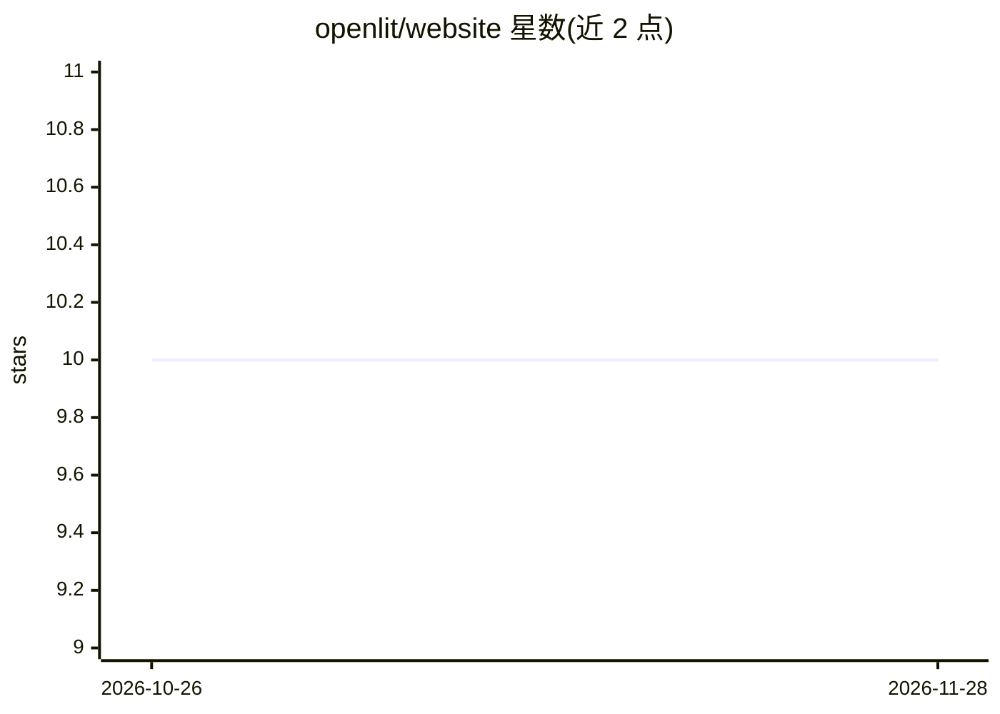

# openlit/website

⭐ 10 · TypeScript · Apache-2.0 · 推送 2026-11-26 · [GitHub](https://github.com/openlit/website) · [官网](https://openlit.io/) · 组织维护

**OpenLIT 官网源码：面向开发者的 LLM 可观测平台营销站**

本仓库是 openlit.io 的网站源码，OpenLIT 产品本体位于 openlit/openlit 仓库。OpenLIT 定位为开源 agent harness 工程平台，基于 OpenTelemetry 提供 agent 可观测性、评估、护栏、提示词管理以及成本与 GPU 监控，可自托管。网站包含营销页面（首页、定价、对比、博客、关于）、概念页与术语表，并提供 llms.txt 等机器可读内容与 SEO/JSON-LD 元数据。接受社区贡献，采用 Apache-2.0 许可。

## 筛选速览

| 维度 | 判定 | 备注 |
|---|---|---|
| AI 角色 | `ai-ecosystem` | LLM/agent 周边工具 |
| 许可风险 | `permissive` | Apache-2.0 |
| 部署形态 | `None` |  |
| 模型依赖 | — | README 未给出锁定关系 |
| 硬件要求 | — | 无带数字的原话,不猜 |
| 安装摩擦 | `low` | 无编译、无系统依赖或容器化 |
| 成熟度 | — | 结构信号不足 |

## 能力要点

- OpenTelemetry-native 的 agent 可观测、评估、护栏与提示词管理
- 成本与 GPU 监控，Apache 2.0 可自托管
- 提供 llms.txt、llms-full.txt 及 Markdown 镜像等机器可读内容
- 含 SEO/AEO 元数据与 JSON-LD 结构化数据

## 适用场景

- 为 AI agent 应用接入 OpenTelemetry 链路追踪与评估
- 团队自托管监控 LLM 应用成本与 GPU 使用
- 查阅 agent harness 工程概念与术语表内容

## 场景标签

 · 领域:LLM 基础设施/可观测性

## 证据(README 行号)

> L18: **OpenLIT is the open-source agent harness engineering platform: trace, evaluate, guard, and improve everything aro
> L22: OpenLIT gives teams OpenTelemetry-native agent observability, evaluations, guardrails, prompt management, and cost 

## 星数曲线

2026-10-26 10 → 2026-11-28 10（+0）

---
*卡片 v1 · prompt 1.4 · 生成 2026-11-19 · 置信度 high · 依据 README sha `612565973bec` · [字段定义](../../DATASET.md)*
