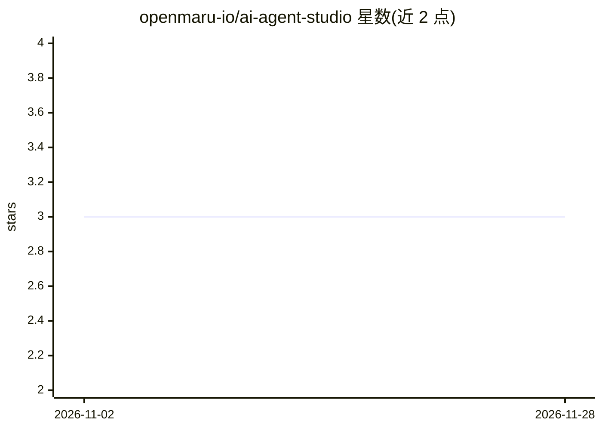

# openmaru-io/ai-agent-studio

⭐ 3 · TypeScript · Apache-2.0 · 推送 2026-11-24 · [GitHub](https://github.com/openmaru-io/ai-agent-studio) · [官网](https://www.openmaru.io/) · 组织维护

**Hermes Agent 的 Web 控制台：监控、对话并协作多 agent**

面向 Nous Research Hermes Agent 的自托管 Web 控制台：浏览器内监控多个 Hermes 安装（AI Agent Workspace）及其 profile 状态，直接聊天并查看工具调用步骤、审批命令执行；提供 3D 办公室、看板（卡片下发到 Hermes 执行）、会议室与 TFT 房间等协作视图。架构为 Python 服务端 + React UI + 只读 sidecar + Hermes 容器，读写分离，需一个 OpenAI 兼容 LLM 端点（上下文 ≥64k），以 Docker Compose 运行，另支持 Kubernetes 与 Helm 安装。

## 筛选速览

| 维度 | 判定 | 备注 |
|---|---|---|
| AI 角色 | `ai-ecosystem` | LLM/agent 周边工具 |
| 许可风险 | `permissive` | Apache-2.0 |
| 部署形态 | `self-host` | docker 或自建部署 |
| 模型依赖 | local-ok | 支持本地模型 |
| 硬件要求 | — | 无带数字的原话,不猜 |
| 安装摩擦 | `low` | 无编译、无系统依赖或容器化 |
| 成熟度 | — | 结构信号不足 |

## 能力要点

- Dashboard/收件箱集中呈现失败任务、断连 messenger 与错误
- 命令执行支持 Allow once/always/Deny 等审批选项
- 3D 办公室、看板、会议房间中可视化 agent 状态与协作
- 浏览器内文件查看器（HWP/DOCX/XLSX/PPTX/PDF 等），不外发转换

## 适用场景

- 在一块屏幕上监控多个 Hermes agent 工作区的运行状态
- 通过看板给 agent 派任务并审批其结果
- 组织人与多个 agent 参加的会议并导出纪要
- 为团队管理员管理用户角色与 agent 可见范围

## 场景标签

`多智能体` · 领域:Agent 开发

## 证据(README 行号)

> L5: CogentAI AI Agent Studio is a web console for Hermes Agent (Nous Research). Use it to monitor many AI Agents that ru
> L144: - **AI Agent Studio server** (`aas/`): Python. It also serves the web UI (`ui/`, React). It keeps its own data (ac
> L146: - **Hermes Agent**: the public image `nousresearch/hermes-agent`. One container runs the Hermes dashboard API and 

## 星数曲线

2026-11-02 3 → 2026-11-28 3（+0）

---
*卡片 v1 · prompt 1.4 · 生成 2026-11-21 · 置信度 high · 依据 README sha `53b6ce048182` · [字段定义](../../DATASET.md)*
