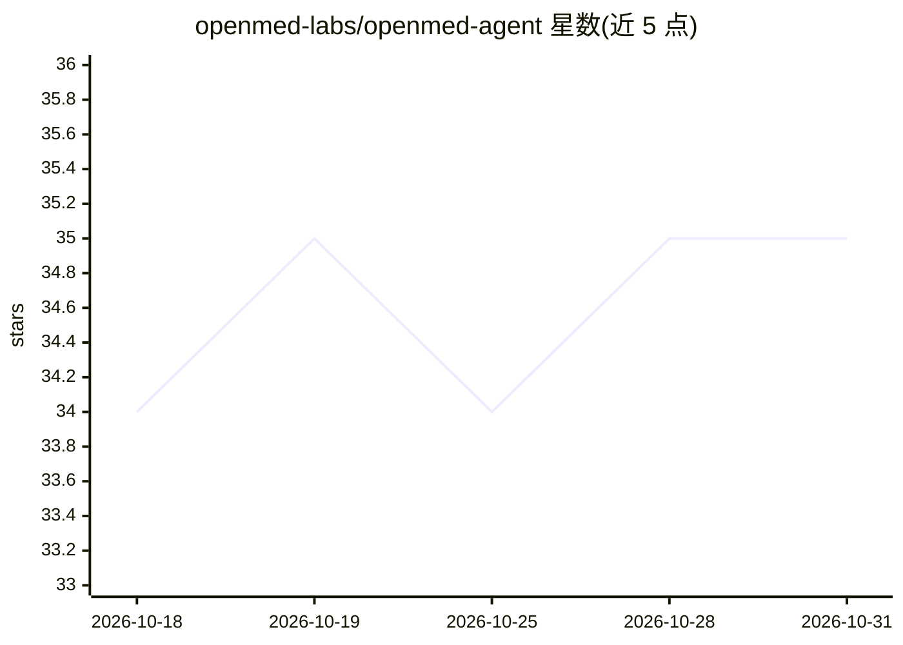

# openmed-labs/openmed-agent

⭐ 35 · Apache-2.0 · 推送 2026-10-06 · [GitHub](https://github.com/openmed-labs/openmed-agent) · [官网](http://agent.openmed.life/) · 组织维护

**面向临床工作流的终端 AI agent：预授权、编码审计与文档**

OpenMed Agent 是运行在终端的临床工作流 agent，供临床医生、医疗运营与技术团队处理临床记录、预授权与申诉、ICD-10 编码审计、结构化文档生成与护理协调等任务。用户选择模型供应商、描述任务后，在可审查的工作区中查看计划、引用与工作流产物后再定稿；内置 ICD-10/CPT/SNOMED CT/LOINC/RxNorm 等医学术语工具，支持自定义 OpenAI 兼容服务器与可选 MCP。当前处于 preview 阶段，安装说明仅向获批评估者提供，部分医疗服务由 OpenMed 运营，PHI 处理模式不提供整体隐私保证。

## 筛选速览

| 维度 | 判定 | 备注 |
|---|---|---|
| AI 角色 | `ai-native` | 本体是模型或模型工具 |
| 许可风险 | `permissive` | Apache-2.0 |
| 部署形态 | `None` |  |
| 模型依赖 | — | README 未给出锁定关系 |
| 硬件要求 | — | 无带数字的原话,不猜 |
| 安装摩擦 | `low` | 无编译、无系统依赖或容器化 |
| 成熟度 | `idea` | |

## 能力要点

- 预授权/申诉、ICD-10 编码审计、临床文档、护理协调等临床工作流
- 覆盖 ICD-10/CPT/SNOMED CT/LOINC/RxNorm/HCC 等术语与风险模型工具
- 可审查工作区：完成前检视工作流预览、产物、引用与差异
- 支持 OpenAI/Anthropic/OpenRouter/MiMo/Doubleword API key 及 OpenAI 兼容服务器

## 适用场景

- 审查预授权请求并起草可复核的申诉材料
- 审计 ICD-10 编码并查看 HCC/RAF 上下文
- 把诊疗笔记或录音转写为结构化临床文档
- 汇总 Apple Health/FHIR 等个人健康数据导出

## 场景标签

`AI 助手` `文档解析` · 领域:对话与助手

## 证据(README 行号)

> L5: OpenMed Agent helps clinicians, healthcare operators, and technical teams work with clinical records, prior authoriz
> L41: |Prior authorization and appeals|Review requests, coverage criteria, and denial evidence; prepare reviewable drafts

## 星数曲线

2026-10-18 34 → 2026-10-31 35（+1）

---
*卡片 v1 · prompt 1.4 · 生成 2026-10-25 · 置信度 high · 依据 README sha `fc35b3232281` · [字段定义](../../DATASET.md)*
