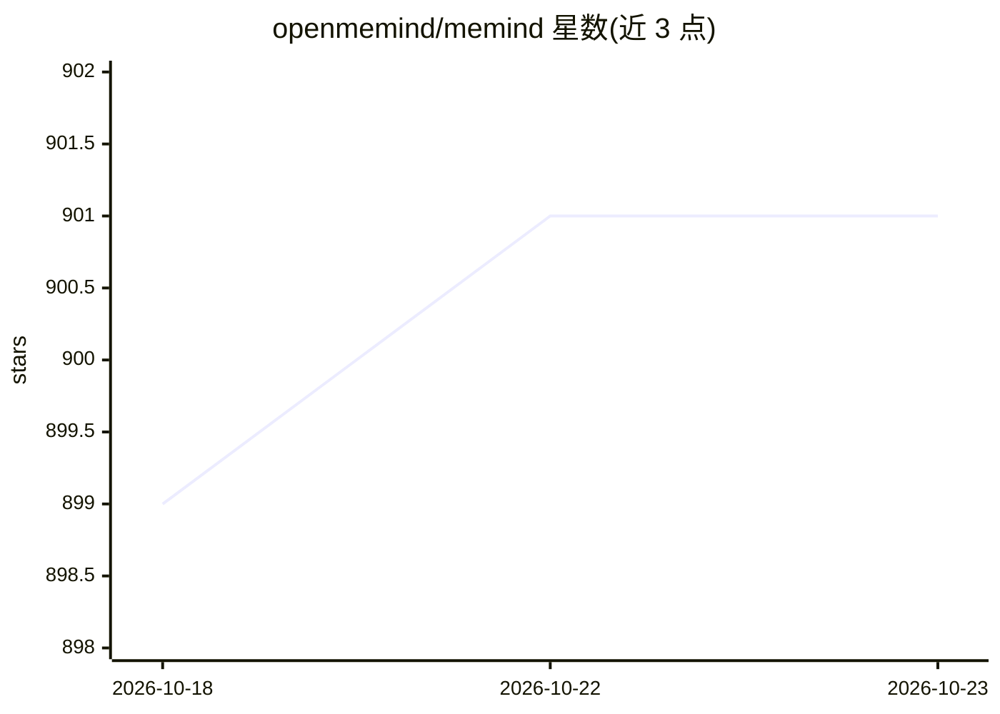

# openmemind/memind

⭐ 901 · Java · Apache-2.0 · 推送 2026-08-13 · [GitHub](https://github.com/openmemind/memind) · [官网](https://docs.openmemind.com) · 组织维护 · 中文 README

**Java 原生的 AI agent 记忆与上下文引擎**

面向 AI 应用与 agent 的开源记忆引擎，用 Java 21 编写：摄取对话、文档、图像、音频、工具调用与任务时间线，生成结构化用户记忆与可复用 agent 经验，组织为 Insight Tree、Memory Graph、Memory Thread，通过多层检索召回上下文。提供 Docker Compose、源码运行与嵌入式 Java 运行时三种方式，经 REST、MCP（11+ 工具）、5 个 SDK 与 4 个 agent 插件接入。模型层基于 Spring AI 的 OpenAI 兼容通道，需自备模型 key；默认 SQLite 存储，支持 MySQL/PostgreSQL。README 报告在 LoCoMo、LongMemEval、PersonaMem 三个基准的列出基线中排名第一。

## 筛选速览

| 维度 | 判定 | 备注 |
|---|---|---|
| AI 角色 | `ai-ecosystem` | LLM/agent 周边工具 |
| 许可风险 | `permissive` | Apache-2.0 |
| 部署形态 | `self-host` | docker 或自建部署 |
| 模型依赖 | — | README 未给出锁定关系 |
| 硬件要求 | — | 无带数字的原话,不猜 |
| 安装摩擦 | `low` | 无编译、无系统依赖或容器化 |
| 成熟度 | — | 结构信号不足 |

## 能力要点

- Leaf→Branch→Root 的 Insight Tree 持续蒸馏记忆
- Memory Graph 实体/因果/时序链接 + 向量与 BM25 多层检索
- 用户记忆与 agent 记忆分离，覆盖编码 agent、聊天、工作流等场景
- Docker Compose / 源码 / 嵌入式 Java 运行时三种部署路径

## 适用场景

- 给我的编码 agent 跨会话保留项目上下文与已解决任务经验
- 为聊天机器人或陪伴应用维护用户画像与生活事件记忆
- 在 Spring Boot 应用内嵌入长期记忆引擎

## 场景标签

`Agent 记忆` `RAG` · 领域:Agent 开发

## 证据(README 行号)

> L37: - ☕ **The first Java-native SOTA memory and context engine for AI agents:** built natively in Java, memind brings b
> L50: Memind is an open-source, self-evolving memory and context engine for AI applications and agents.
> L308: Memind can be integrated through first-party agent plugins, SDKs, REST APIs, or the built-in HTTP MCP server.

## 星数曲线

2026-10-18 899 → 2026-10-23 901（+2）

---
*卡片 v1 · prompt 1.4 · 生成 2026-10-21 · 置信度 mid · 依据 README sha `10fb6f20ca23` · [字段定义](../../DATASET.md)*
