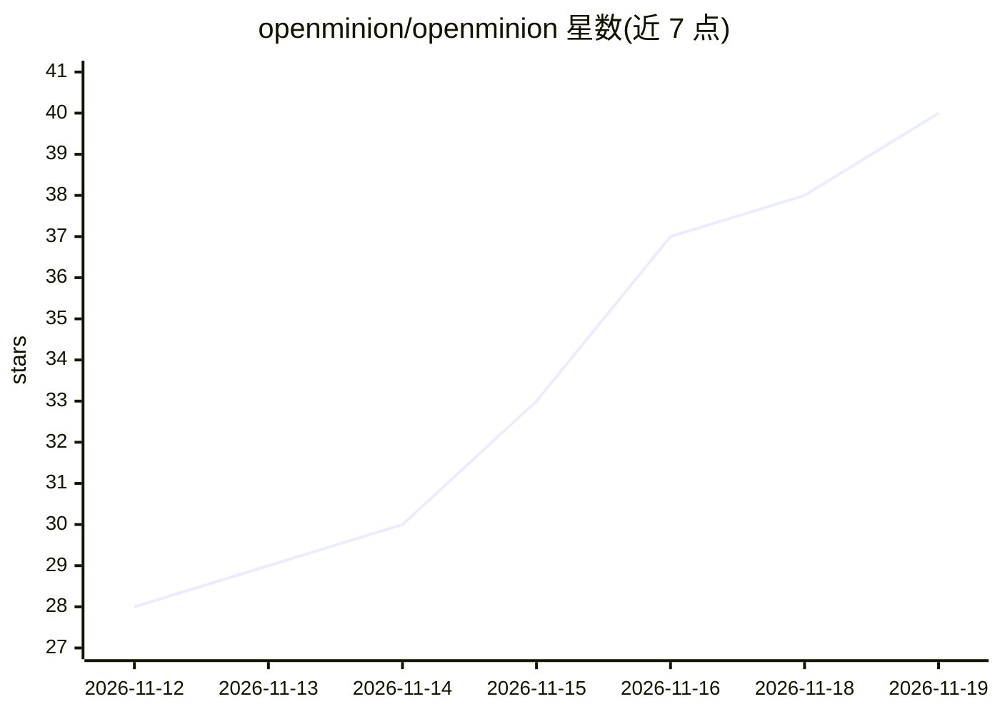

# openminion/openminion

⭐ 40 · Python · Apache-2.0 · 推送 2026-11-18 · [GitHub](https://github.com/openminion/openminion) · 组织维护

**本地优先的 Python 工具调用 AI agent 运行时**

在用户本机运行可检视 agent 的运行时，提供 CLI、Python API、本地 HTTP API 与 daemon 四种执行面，统一编排模型与结构化工具；内置会话、运行、产物与记忆记录的持久化本地状态，权限分 Read only/Ask/Workspace auto/Full 四级并受 action_policy 约束，支持 MCP 命令与多 agent Focus room。0.1.x 公开预览阶段，明确不提供无人值守长时自主、托管云控制面或签名桌面安装包。面向在本地构建工具型 agent 工作流的开发者和运维者。

## 筛选速览

| 维度 | 判定 | 备注 |
|---|---|---|
| AI 角色 | `ai-ecosystem` | LLM/agent 周边工具 |
| 许可风险 | `permissive` | Apache-2.0 |
| 部署形态 | `library` | 以包/库形式分发 |
| 模型依赖 | — | README 未给出锁定关系 |
| 硬件要求 | — | 无带数字的原话,不猜 |
| 安装摩擦 | `low` | 无编译、无系统依赖或容器化 |
| 成熟度 | `idea` | |

## 能力要点

- CLI / Python API / 本地 HTTP / daemon 四种运行面共享一套编排模型
- 本地持久化 session、run、artifact、memory-record 状态
- 策略门控的结构化工具执行与四级权限模式
- MCP 命令、多 agent 房间与 OpenTelemetry-ready 追踪

## 适用场景

- 在本机以 CLI 或 Python 嵌入方式运行工具调用 agent
- 通过本地 HTTP API 或 daemon 接入外部进程提交任务
- 以权限策略和可检视运行状态管理 agent 的文件与命令操作

## 场景标签

`Agent 框架` `多智能体` · 领域:Agent 开发

## 证据(README 行号)

> L18: OpenMinion is the public preview of a runtime for running inspectable
> L19: agents on your own machine. One shared runtime spans CLI, Python API, HTTP API,
> L256: - one orchestration model across CLI, Python, HTTP, and daemon-backed paths
> L257: - provider abstraction for local and hosted model backends

## 星数曲线

2026-11-12 28 → 2026-11-19 40（+12）

---
*卡片 v1 · prompt 1.4 · 生成 2026-11-18 · 置信度 high · 依据 README sha `91c5400da77e` · [字段定义](../../DATASET.md)*
