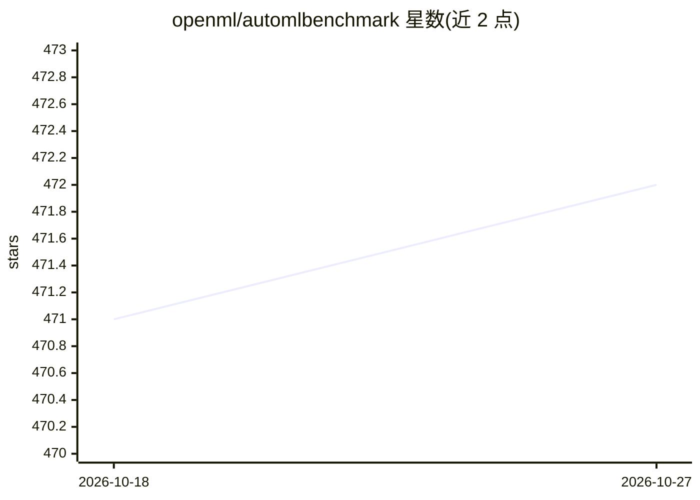

# openml/automlbenchmark

⭐ 472 · Python · MIT · 推送 2026-10-19 · [GitHub](https://github.com/openml/automlbenchmark) · [官网](https://openml.github.io/automlbenchmark) · 组织维护

**评估与对比开源 AutoML 系统的基准测试框架**

由 OpenML 维护的 AutoML 基准测试框架：提供来自 OpenML 的精选数据集套件（回归、分类），内置对多个开源 AutoML 系统的基准测试代码，支持添加新的 AutoML 框架与数据集。实验可在 Docker 或 Singularity 容器中运行，并支持本地或 AWS 上执行。目标是通过标准化环境解决 AutoML 研究中缺乏统一基准、结果难以复现与对比的问题。安装与使用文档见官方网站。

## 筛选速览

| 维度 | 判定 | 备注 |
|---|---|---|
| AI 角色 | `ai-ecosystem` | LLM/agent 周边工具 |
| 许可风险 | `permissive` | MIT |
| 部署形态 | `None` |  |
| 模型依赖 | — | README 未给出锁定关系 |
| 硬件要求 | — | 无带数字的原话,不猜 |
| 安装摩擦 | `low` | 无编译、无系统依赖或容器化 |
| 成熟度 | — | 结构信号不足 |

## 能力要点

- 来自 OpenML 的精选基准数据集套件（回归、分类）
- 内置多个流行 AutoML 系统的基准测试代码，可添加新框架
- 实验可在 Docker 或 Singularity 容器中运行
- 支持本地或 AWS 上执行实验

## 适用场景

- 对比多个开源 AutoML 系统在标准任务上的表现
- 为自己的 AutoML 框架做标准化评测
- 复现 AutoML 实验结果以便论文对比

## 场景标签

`模型评测` · 领域:评测与运维

## 证据(README 行号)

> L2: The OpenML AutoML Benchmark provides a framework for evaluating and comparing open-source AutoML systems.
> L27: * Includes code to benchmark a number of popular AutoML systems on regression and classification tasks.

## 星数曲线

2026-10-18 471 → 2026-10-27 472（+1）

---
*卡片 v1 · prompt 1.4 · 生成 2026-10-21 · 置信度 high · 依据 README sha `2b97b2bd9324` · [字段定义](../../DATASET.md)*
