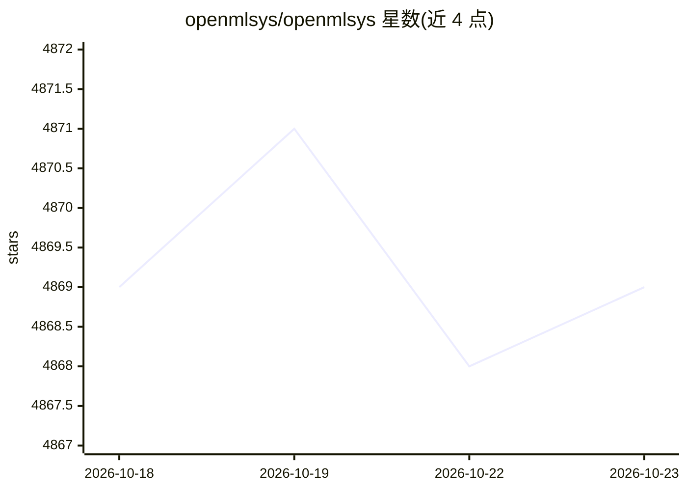

# openmlsys/openmlsys

⭐ 4,869 · TeX · 推送 2026-03-15 · [GitHub](https://github.com/openmlsys/openmlsys) · [官网](https://openmlsys.github.io/v1/cn/) · 组织维护 · 中文 README

**开源教材《机器学习系统：设计和实现》，面向学生/科研/工程开发者**

一本讲解现代机器学习系统设计原理与实现经验的开源书籍，第二版共9章，内容覆盖编程接口与计算图、AI加速器编程（CUDA/Triton/CUTLASS）、AI编译器与运行时、数据处理系统、训练系统、模型服务、强化学习系统及大规模GPU集群管理。面向希望深入系统底层的学生、需开发自定义算子或做分布式训练的科研人员、以及从事基础设施建设的工程师。提供中英文在线阅读，可用 mdbook 脚本本地构建 HTML，采用 CC BY-NC-SA 4.0 许可。

## 筛选速览

| 维度 | 判定 | 备注 |
|---|---|---|
| AI 角色 | `ai-knowledge` | 知识聚合/清单类 |
| 许可风险 | `none` | — |
| 部署形态 | `None` |  |
| 模型依赖 | — | README 未给出锁定关系 |
| 硬件要求 | — | 无带数字的原话,不猜 |
| 安装摩擦 | `medium` | 含编译或系统依赖之一 |
| 成熟度 | — | 结构信号不足 |

## 能力要点

- 第二版共9章，覆盖从编程接口到GPU集群管理的完整技术栈
- 提供中文与英文双版本在线阅读
- 提供 git clone + 脚本构建本地 HTML 的方式
- 内容涉及 CUDA/Triton/CUTLASS 编程与 AI 编译器实现

## 适用场景

- 系统学习机器学习系统的设计与实现
- 开发自定义算子或分布式训练方案前查阅技术背景
- 构建机器学习基础设施时参考性能调优与架构设计

## 场景标签

`教程课程` · 领域:学习与行业

## 证据(README 行号)

> L20: 本开源项目讲解现代机器学习系统的设计原理和实现经验，涵盖从编程接口、计算图、编译器到分布式训练的完整技术栈。
> L34: 本书（第二版）共分9章：

## 星数曲线

2026-10-18 4,869 → 2026-10-23 4,869（+0）

---
*卡片 v1 · prompt 1.4 · 生成 2026-10-20 · 置信度 high · 依据 README sha `01f000e3b560` · [字段定义](../../DATASET.md)*
