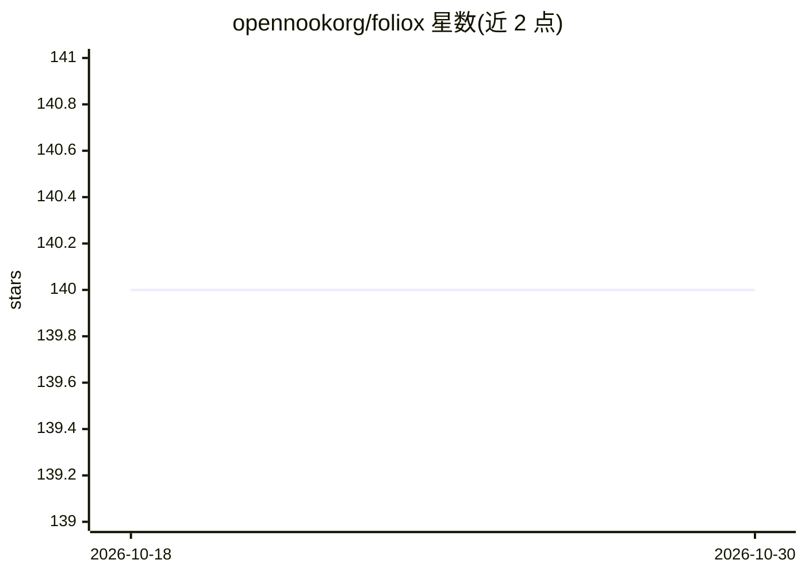

# opennookorg/foliox

⭐ 140 · TypeScript · GPL-3.0 · 推送 2025-12-12 · [GitHub](https://github.com/opennookorg/foliox) · [官网](https://www.foliox.site) · 个人维护

**从 GitHub 资料自动生成开发者作品集网站的 AI 应用**

基于 Next.js 16 的 Web 应用：输入 GitHub 用户名后，通过 GitHub GraphQL API 抓取个人资料、仓库、贡献图与项目统计，调用 Groq AI（Llama 3.1 8B，经 Vercel AI SDK）生成专业简介、亮点与 SEO 描述，输出响应式作品集页面。支持自定义分享 URL、数据库缓存、可选 LinkedIn 数据抓取与项目主页截图。自部署需 Node.js 20+、PostgreSQL 与 Groq API key；支持 GitHub OAuth 登录以纳入私有仓库。

## 筛选速览

| 维度 | 判定 | 备注 |
|---|---|---|
| AI 角色 | `ai-native` | 本体是模型或模型工具 |
| 许可风险 | `viral` | GPL-3.0 |
| 部署形态 | `library` | 以包/库形式分发 |
| 模型依赖 | locked-api |  |
| 硬件要求 | — | 无带数字的原话,不猜 |
| 安装摩擦 | `low` | 无编译、无系统依赖或容器化 |
| 成熟度 | — | 结构信号不足 |

## 能力要点

- GitHub 数据抓取后由 Groq AI 生成简介、亮点与 SEO 描述
- 自定义分享 URL（3-40 字符 slug 校验与唯一性检查）
- PostgreSQL 数据库缓存，默认 TTL 1 小时，减少外部 API 调用
- GitHub OAuth 登录后可在作品集中纳入私有仓库

## 适用场景

- 开发者快速生成个人作品集网站
- 求职或展示时用自定义 URL 分享作品集
- 自部署为自己的作品集生成服务

## 场景标签

`AI 写作` · 领域:内容生成

## 证据(README 行号)

> L3: Foliox is an AI-powered portfolio generator that automatically creates beautiful developer portfolios from GitHub pr
> L21: 3. **AI Processing**: Groq AI analyzes the profile and generates professional summaries and highlights
> L174: - **AI**: Vercel AI SDK with Groq provider (Llama 3.1 8B)

## 星数曲线

2026-10-18 140 → 2026-10-30 140（+0）

---
*卡片 v1 · prompt 1.4 · 生成 2026-10-22 · 置信度 high · 依据 README sha `8bd57b2d2791` · [字段定义](../../DATASET.md)*
