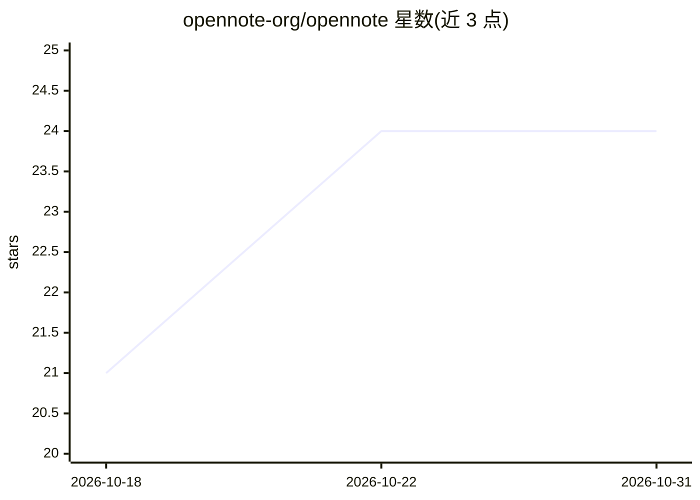

# opennote-org/opennote

⭐ 24 · Rust · MIT · 推送 2026-10-29 · [GitHub](https://github.com/opennote-org/opennote) · 个人维护 · 中文 README

**纯 Rust 编写的本地优先 AI 笔记应用**

基于 GPUI 的桌面笔记本应用：提供 WYSIWYG Markdown 编辑器、关键词与语义搜索（可让文档回答问题）、全本地数据存储（SQLite + sqlite-vector 向量库），并内置默认开启的 MCP 服务器（localhost:8080，Streamable HTTP），供 MCP 客户端访问。首次启动自动从 Hugging Face 下载 sentence-transformers all-MiniLM-L6-v2 嵌入模型（可回退 hf-mirror 镜像）。支持可选的自托管服务器进行加密跨设备同步；切换嵌入模型后可触发全量重建索引。项目声明处于重度开发阶段，API 与架构仍在演进。

## 筛选速览

| 维度 | 判定 | 备注 |
|---|---|---|
| AI 角色 | `ai-native` | 本体是模型或模型工具 |
| 许可风险 | `permissive` | MIT |
| 部署形态 | `desktop` | 安装包/桌面程序 |
| 模型依赖 | — | README 未给出锁定关系 |
| 硬件要求 | — | 无带数字的原话,不猜 |
| 安装摩擦 | `low` | 无编译、无系统依赖或容器化 |
| 成熟度 | `idea` | |

## 能力要点

- 关键词与语义搜索，基于本地嵌入模型（all-MiniLM-L6-v2）
- 全本地运行，SQLite 关系库与 sqlite-vector 向量存储
- 内置 MCP 服务器（默认开启，loopback 防护，免认证）
- 可选自托管服务器做加密跨设备同步

## 适用场景

- 本地管理 Markdown 笔记并用语义搜索检索
- 让 MCP 客户端（如 AI 助手）访问我的笔记库
- 多设备间通过自托管服务器同步笔记

## 场景标签

`知识库管理` `语义搜索` · 领域:知识与检索

## 证据(README 行号)

> L11: - **Keyword and semantic search** — find notes instantly, or let your documents answer your questions.
> L54: The MCP server is **enabled by default** and listens on `http://localhost:8080/`. Toggle it and change its address 

## 星数曲线

2026-10-18 21 → 2026-10-31 24（+3）

---
*卡片 v1 · prompt 1.4 · 生成 2026-10-27 · 置信度 high · 依据 README sha `a7dc01f5cd07` · [字段定义](../../DATASET.md)*
