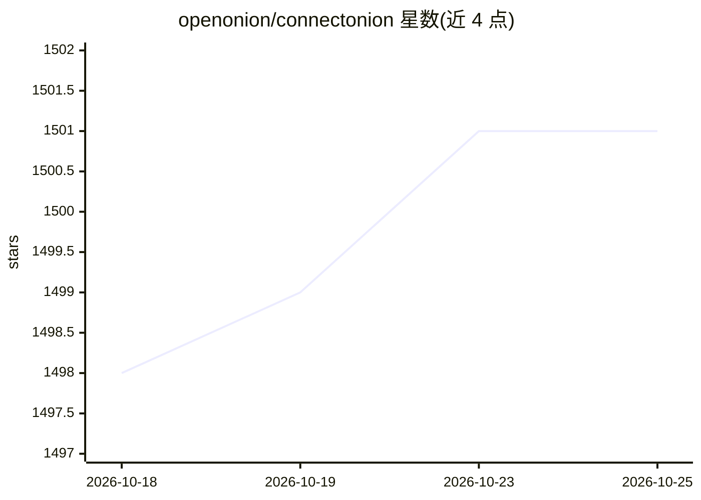

# openonion/connectonion

⭐ 1,501 · Python · Apache-2.0 · 推送 2026-10-25 · [GitHub](https://github.com/openonion/connectonion) · [官网](https://docs.connectonion.com) · 组织维护

**给 AI agent 统一 CLI 工具面的 harness：一个 co 命令接入邮件/浏览器/聊天等**

以单条命令 co 向 Claude Code、Codex、Cursor 等编码 agent 暴露工具：Gmail/Outlook、登录态浏览器、文件、聊天应用、Linear/Canny 等，agent 通过 --help 按需发现命令，凭据保存在本地。co rem 功能把邮件与编码会话的上下文整理为本地 Markdown 页面供 agent 复用（每日调度目前需 macOS）。同时是可用 Python 框架构建自有 agent。安装经 install.sh（uv）或 pip。

## 筛选速览

| 维度 | 判定 | 备注 |
|---|---|---|
| AI 角色 | `ai-ecosystem` | LLM/agent 周边工具 |
| 许可风险 | `permissive` | Apache-2.0 |
| 部署形态 | `library` | 以包/库形式分发 |
| 模型依赖 | local-ok | 支持本地模型 |
| 硬件要求 | — | 无带数字的原话,不猜 |
| 安装摩擦 | `low` | 无编译、无系统依赖或容器化 |
| 成熟度 | — | 结构信号不足 |

## 能力要点

- 单命令 co 覆盖邮件、浏览器、文件、聊天、Issues 等工具，agent 经 --help 按需发现
- 凭据存于本机 ~/.co/keys.env，重要写入需 --yes 预览确认
- co rem 将邮件与编码会话上下文生成本地 Markdown 页面供后续任务复用
- co audit 按 agent 视角为 CLI 帮助页打分，CI 强制校验

## 适用场景

- 让 Claude Code/Codex/Cursor 用同一命令行操作邮箱、浏览器与聊天应用
- 把邮件和编码会话的上下文沉淀为本地页面供下次任务使用
- 在不安装插件的前提下给任意 shell 可执行 agent 接入工具

## 场景标签

`Agent 框架` · 领域:Agent 开发

## 证据(README 行号)

> L5: **The agent CLI harness. CLI is all you need.**
> L7: One command line, `co`, gives your AI agent the accounts and tools it works with:
> L260: ConnectOnion is also a Python framework for building your own agents on the

## 星数曲线

2026-10-18 1,498 → 2026-10-25 1,501（+3）

---
*卡片 v1 · prompt 1.4 · 生成 2026-10-21 · 置信度 high · 依据 README sha `077b1a08a7f0` · [字段定义](../../DATASET.md)*
