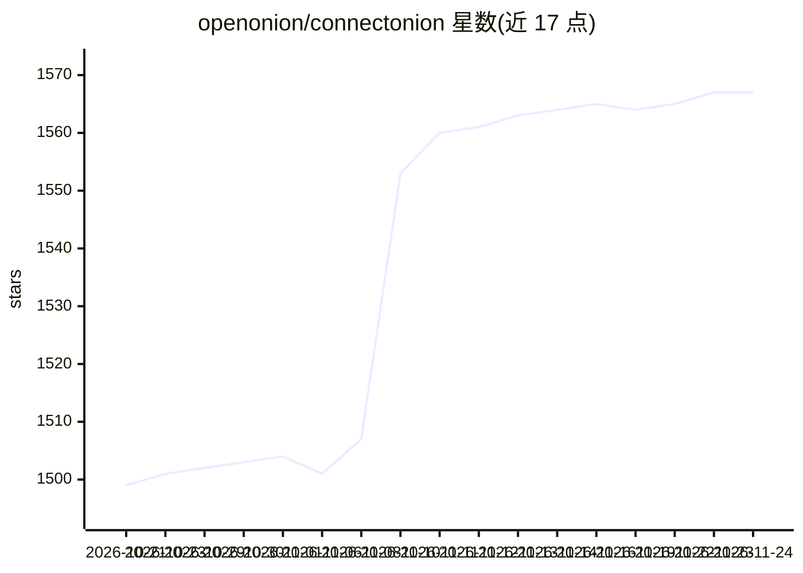

# openonion/connectonion

⭐ 1,567 · Python · Apache-2.0 · 推送 2026-11-22 · [GitHub](https://github.com/openonion/connectonion) · [官网](https://docs.connectonion.com) · 组织维护

**给 AI agent 的统一 CLI 工具链：一条命令接入邮件、浏览器、聊天与工具**

ConnectOnion 提供单条命令行 `co`，让 AI agent 通过 shell 使用 Gmail、Outlook、浏览器、文件、聊天应用、任务跟踪及其他 agent。设计机制是：agent 通过 `--help` 按需发现工具，帮助页即提示词，CI 用 `co audit` 校验帮助页完整性；凭据保存在本机，重要写入需预览确认。附带 `co rem` 本地 Markdown 上下文管理，以及一个 Python 框架用于构建自己的 agent。安装用 curl 脚本或 pip；每日调度当前要求 macOS。

## 筛选速览

| 维度 | 判定 | 备注 |
|---|---|---|
| AI 角色 | `ai-ecosystem` | LLM/agent 周边工具 |
| 许可风险 | `permissive` | Apache-2.0 |
| 部署形态 | `library` | 以包/库形式分发 |
| 模型依赖 | — | README 未给出锁定关系 |
| 硬件要求 | — | 无带数字的原话,不猜 |
| 安装摩擦 | `low` | 无编译、无系统依赖或容器化 |
| 成熟度 | — | 结构信号不足 |

## 能力要点

- 一条 `co` 命令让 agent 使用邮件、日历、浏览器、聊天与 issue 工具
- 工具通过 `--help` 按需发现，帮助页即提示词，`co audit` 做 CI 校验
- co rem 将邮件与编码会话上下文整理为本地链接的 Markdown 页面
- 同时是构建自有 agent 的 Python 框架

## 适用场景

- 让 Claude Code/Codex 等编码 agent 直接读取和回复 Outlook 邮件
- 把邮件、Slack、Linear 里的上下文整理成本地可检索的 Markdown 笔记
- 给自建 agent 提供统一 shell 工具接口，免去逐个 MCP 服务器配置

## 场景标签

`Agent 框架` · 领域:Agent 开发

## 证据(README 行号)

> L5: **The agent CLI harness. CLI is all you need.**
> L275: ConnectOnion is also a Python framework for building your own agents on the
> L20:  CLI as your harness. No MCP servers, adapters or glue: a CLI

## 星数曲线

2026-10-21 1,499 → 2026-11-24 1,567（+68）

---
*卡片 v1 · prompt 1.4 · 生成 2026-11-23 · 置信度 high · 依据 README sha `efda23240e77` · [字段定义](../../DATASET.md)*
