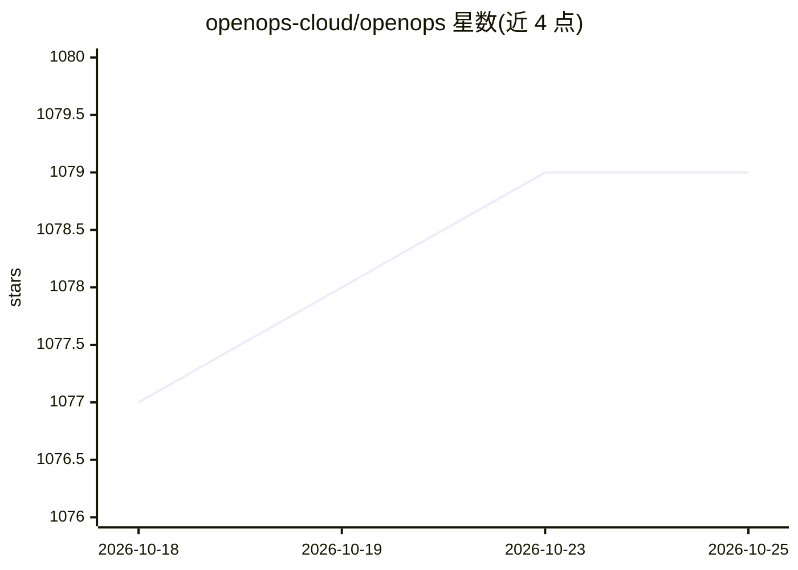

# openops-cloud/openops

⭐ 1,079 · TypeScript · NOASSERTION · 推送 2026-10-23 · [GitHub](https://github.com/openops-cloud/openops) · [官网](https://www.openops.com) · 组织维护

**无代码 FinOps 自动化平台：帮组织降低云成本并自动化财务运营流程**

面向 FinOps 团队、工程师、DevOps、财务与管理层的 No-Code FinOps 自动化平台，用于降低云成本并自动化分摊、单位经济性、异常管理、负载优化与闲置资源安全下线等流程。内置类 Excel 数据库（OpenOps Tables）与可视化系统（OpenOps Analytics），提供无代码工作流编辑器、预置工作流库、Human-in-the-Loop 审批控制、版本管理与日志追踪。原生集成 AWS/Azure/Google Cloud 及第三方 FinOps、通讯与项目管理工具。以托管云服务或 docker-compose 安装两种形式提供，采用 Apache 2.0 许可。

## 筛选速览

| 维度 | 判定 | 备注 |
|---|---|---|
| AI 角色 | `ai-enhanced` | 去掉 AI 部分产品仍成立 |
| 许可风险 | `none` | NOASSERTION |
| 部署形态 | `None` |  |
| 模型依赖 | — | README 未给出锁定关系 |
| 硬件要求 | — | 无带数字的原话,不猜 |
| 安装摩擦 | `low` | 无编译、无系统依赖或容器化 |
| 成熟度 | — | 结构信号不足 |

## 能力要点

- 预置 FinOps 工作流库（成本优化、标签、预算、分摊、报告）
- No-Code 工作流编辑器，支持需要时切入代码
- 内置 OpenOps Tables 数据库与 OpenOps Analytics 可视化
- 跨多渠道的 Human-in-the-Loop 审批控制与工作流版本/日志追踪

## 适用场景

- 我想自动化云成本的发现、审批与执行闭环
- 我想把多个 FinOps 工具发现的优化机会集中管理并跟进
- 我想让闲置 RDS 等资源经过审批后安全下线

## 场景标签

`工作流自动化` · 领域:效率与自动化

## 证据(README 行号)

> L10: OpenOps is a **No-Code FinOps automation platform** that helps organizations reduce cloud costs and streamline fina
> L12: It provides **customizable workflows** to automate key FinOps processes like allocation, unit economics, anomaly ma

## 星数曲线

2026-10-18 1,077 → 2026-10-25 1,079（+2）

---
*卡片 v1 · prompt 1.4 · 生成 2026-10-21 · 置信度 mid · 依据 README sha `c1a96f311651` · [字段定义](../../DATASET.md)*
