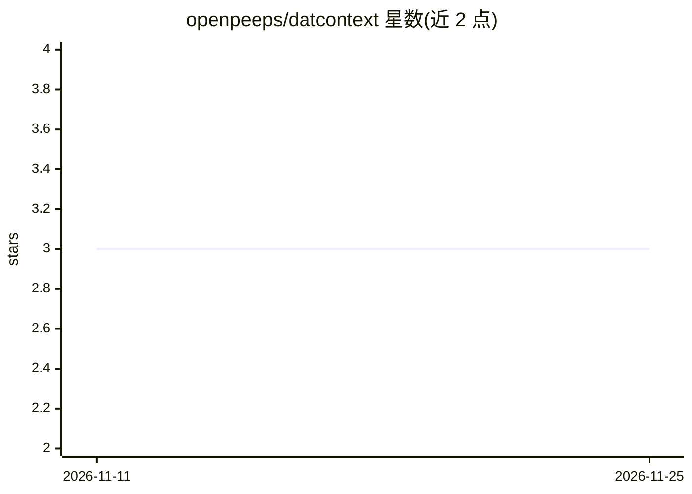

# openpeeps/datcontext

⭐ 3 · Nim · MIT · 推送 2026-10-14 · [GitHub](https://github.com/openpeeps/datcontext) · 组织维护

**Nim 开发者的 MCP 客户端/服务器构建库**

以 Nim 库形式提供的 MCP 协议构建组件，供应用集成而非独立 CLI。提供服务器与客户端两侧的四个传输实现（stdio、Streamable HTTP、Unix socket、TCP），面向 2026-07-28 规范修订并兼容旧版 initialize 握手。默认注册表为空，由上层应用注册工具、资源与提示；内置 JSON Schema 工具注册、协议错误与工具错误的区分、基于 flysystem 的只读文件系统策略（含路径逃逸防护）与跨传输的订阅通知机制。

## 筛选速览

| 维度 | 判定 | 备注 |
|---|---|---|
| AI 角色 | `ai-ecosystem` | LLM/agent 周边工具 |
| 许可风险 | `permissive` | MIT |
| 部署形态 | `None` |  |
| 模型依赖 | — | README 未给出锁定关系 |
| 硬件要求 | — | 无带数字的原话,不猜 |
| 安装摩擦 | `low` | 无编译、无系统依赖或容器化 |
| 成熟度 | — | 结构信号不足 |

## 能力要点

- 客户端/服务器两侧各四种传输（stdio、Streamable HTTP、Unix socket、TCP）
- 空注册表设计，应用自行注册工具/资源/提示
- 只读文件系统策略：隐藏文件拒绝、大小/深度上限、防 `..` 与符号链接逃逸
- 区分协议错误与模型可自纠的工具错误，处理器异常不中断连接

## 适用场景

- 在 Nim 应用中为模型暴露工具、资源与提示
- 构建连接本地子进程或网络服务的 MCP host
- 安全地将项目目录作为只读上下文提供给模型
- 维护需要新旧版 MCP host 都能连接的服务

## 场景标签

 · 领域:AI 生态/MCP 协议开发库

## 证据(README 行号)

> L1: A Nim library for building MCP clients and servers over powpow transports
> L9: - Generic MCP server and client building blocks in Nim
> L48: datcontext ships no binary. High level apps integrate it as a library.

## 星数曲线

2026-11-11 3 → 2026-11-25 3（+0）

---
*卡片 v1 · prompt 1.4 · 生成 2026-11-21 · 置信度 high · 依据 README sha `b57062fbadd4` · [字段定义](../../DATASET.md)*
