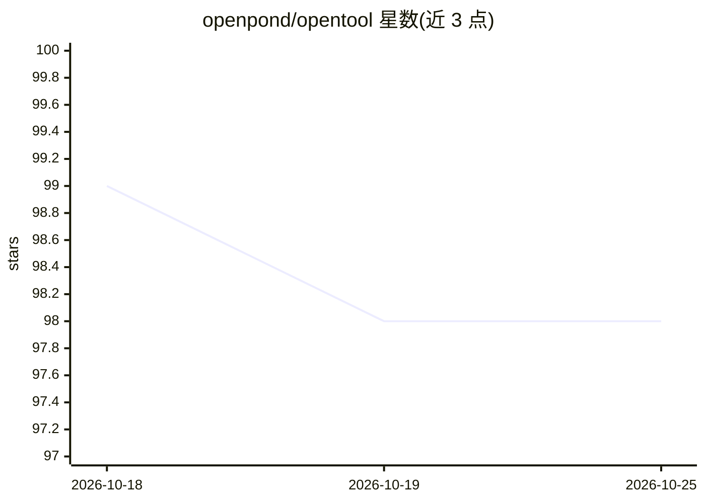

# openpond/opentool

⭐ 98 · JavaScript · MIT · 推送 2026-08-20 · [GitHub](https://github.com/openpond/opentool) · [官网](https://openpond.ai) · 组织维护

**构建可被 AI agent 调用、支持加密支付的 TypeScript 工具框架**

面向开发者的 TypeScript 工具构建框架：编写的函数可被其他 agent 通过 HTTP 或 MCP（如 Claude Desktop）调用，公开工具可用 x402 协议做加密货币付费（返回 402 支付要求、校验 X-PAYMENT 头），私有工具面向交易与链上交互场景。提供 CLI（init/validate/dev/build/metadata），支持 cron 调度声明、邮件通知与三级 metadata 配置；经 OpenPound 平台检测依赖后自动部署到 AWS Lambda。

## 筛选速览

| 维度 | 判定 | 备注 |
|---|---|---|
| AI 角色 | `ai-ecosystem` | LLM/agent 周边工具 |
| 许可风险 | `permissive` | MIT |
| 部署形态 | `library` | 以包/库形式分发 |
| 模型依赖 | — | README 未给出锁定关系 |
| 硬件要求 | — | 无带数字的原话,不猜 |
| 安装摩擦 | `low` | 无编译、无系统依赖或容器化 |
| 成熟度 | — | 结构信号不足 |

## 能力要点

- TypeScript 函数定义为可被 agent 调用的 HTTP/MCP 工具
- x402 加密支付保护公开工具（402/X-PAYMENT 流程）
- CLI 覆盖初始化、校验、本地开发服务器、构建与 metadata 生成
- 通过 OpenPond 连接 GitHub 自动部署至 AWS Lambda

## 适用场景

- 为 AI 助手/agent 开发可调用的自定义工具
- 把工具发布为按次加密付费的公开服务
- 为交易和链上操作编写私有定时工具（cron 调度）

## 场景标签

`Agent 框架` · 领域:Agent 开发

## 证据(README 行号)

> L6: Build serverless TypeScript tools that work with AI assistants, handle crypto payments, and deploy to AWS Lambda aut
> L12: OpenTool lets you write simple TypeScript functions that can be called by other agents, monetized with crypto payme
> L126: By default, tools are HTTP-only. Want them accessible via MCP clients like Claude Desktop? Just add this to your t

## 星数曲线

2026-10-18 99 → 2026-10-25 98（-1）

---
*卡片 v1 · prompt 1.4 · 生成 2026-10-23 · 置信度 high · 依据 README sha `a9476fe2b43a` · [字段定义](../../DATASET.md)*
