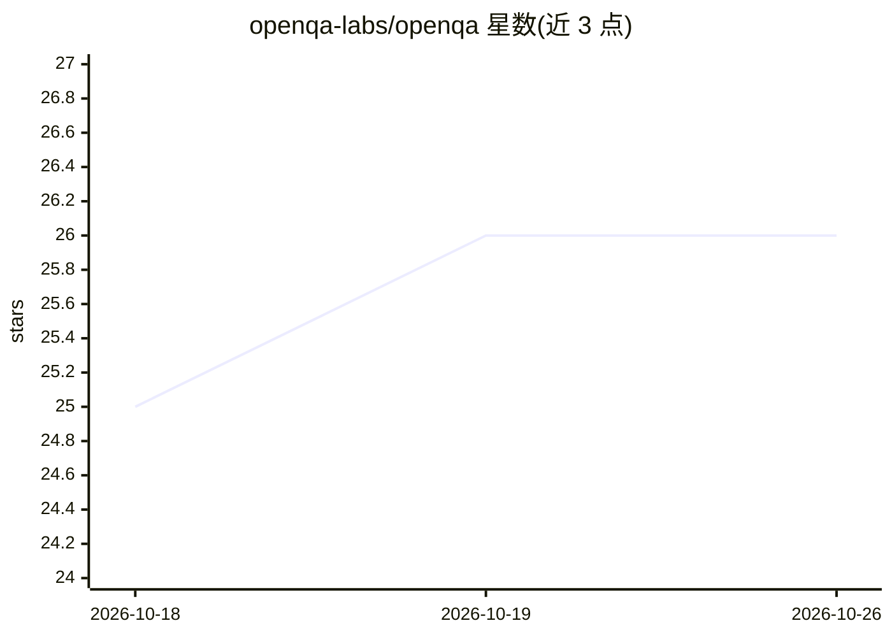

# openqa-labs/openqa

⭐ 26 · JavaScript · 推送 2026-05-25 · [GitHub](https://github.com/openqa-labs/openqa) · [官网](https://www.openqa.io/) · 组织维护

**用自然语言写浏览器端到端测试的 agent 测试框架**

面向前端/测试开发者的开源 agentic 测试 harness：以 Gherkin 或 YAML 编写自然语言步骤，由 AI agent 通过 Playwright MCP 驱动真实浏览器完成操作与断言，无需编写选择器或步骤定义。双引擎可选 Claude Code SDK 或 opencode（支持 Anthropic、OpenAI、Google、GitHub Copilot 等 70+ 供应商），本地登录 CLI 即可用、CI 需配 API key。每次运行产出 HTML 报告、trace viewer 与截图；并行安全（每个 worker 独立端口）。要求 Node.js 18+（脚手架项目 22+）。

## 筛选速览

| 维度 | 判定 | 备注 |
|---|---|---|
| AI 角色 | `ai-ecosystem` | LLM/agent 周边工具 |
| 许可风险 | `permissive` | — |
| 部署形态 | `library` | 以包/库形式分发 |
| 模型依赖 | locked-api |  |
| 硬件要求 | — | 无带数字的原话,不猜 |
| 安装摩擦 | `low` | 无编译、无系统依赖或容器化 |
| 成熟度 | — | 结构信号不足 |

## 能力要点

- 自然语言步骤由 agent 意图驱动浏览器，无选择器、无步骤定义
- 双引擎：Claude Code SDK 或 opencode（70+ 供应商）
- 每次运行输出 HTML 报告、trace viewer 与截图
- Playwright-BDD / Cucumber.js / YAML 三种测试编写方式

## 适用场景

- 用英文自然语言编写 Web 应用的端到端测试
- UI 频繁重构下维持自动化测试可运行
- 在 CI 中运行 agent 驱动的回归测试并留存证据

## 场景标签

`浏览器自动化` · 领域:效率与自动化

## 证据(README 行号)

> L4: **The open-source agentic testing harness. Write tests in plain English — the agent figures out the selectors.**
> L48: 1. Your BDD step definitions call `runAgent(claudeCode('model'), 'natural language step', page)`.

## 星数曲线

2026-10-18 25 → 2026-10-26 26（+1）

---
*卡片 v1 · prompt 1.4 · 生成 2026-10-26 · 置信度 high · 依据 README sha `a8c8fbc2a4f3` · [字段定义](../../DATASET.md)*
