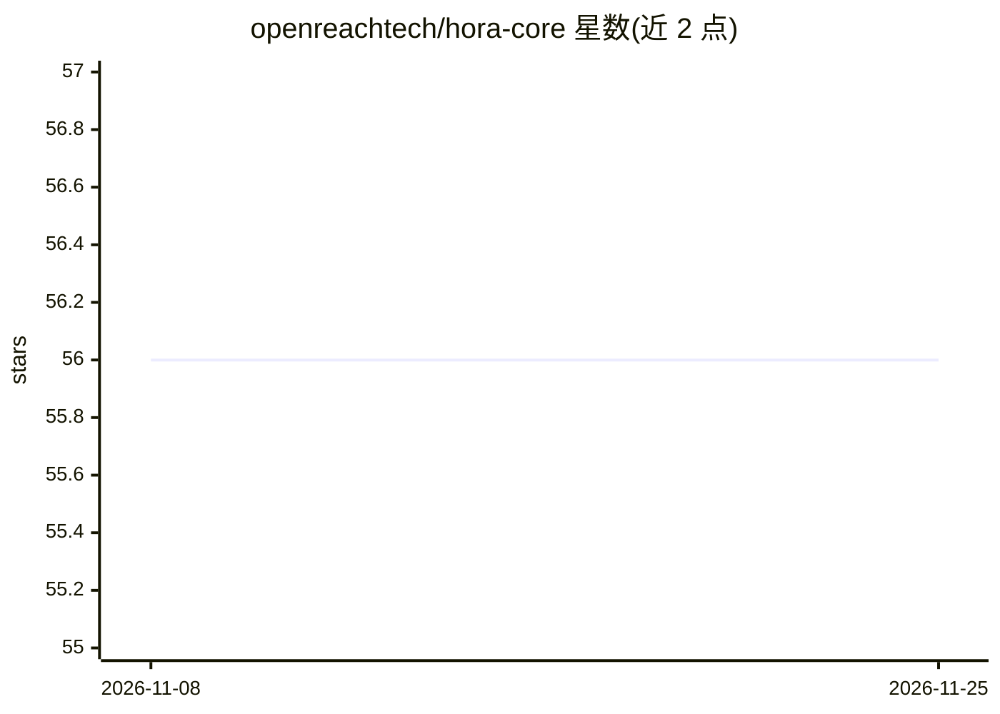

# openreachtech/hora-core

⭐ 56 · JavaScript · Apache-2.0 · 推送 2026-11-17 · [GitHub](https://github.com/openreachtech/hora-core) · [官网](https://openreach.tech/#hora) · 组织维护

**向 Claude Code 等 agent 工具投放技能与子代理定义的 npm 载具包**

Hora Kit 的核心模块容器：携带 agents 与 skills 定义（kit/ 目录），通过唯一可执行命令 hora-core install 将其复制到仓库的 .claude/ 目录，供 Claude Code 等 agent 工具读取并以斜杠命令调用。通常经 GitHub 模板项目引入，也可手动 npm 安装并配置 postinstall；install 可重复执行，按 .hora/equip-core.json 记录清除旧安装；拒绝符号链接路径。包内无可导入代码，npm 发布的是 dist/ 构建产物。

## 筛选速览

| 维度 | 判定 | 备注 |
|---|---|---|
| AI 角色 | `ai-ecosystem` | LLM/agent 周边工具 |
| 许可风险 | `permissive` | Apache-2.0 |
| 部署形态 | `library` | 以包/库形式分发 |
| 模型依赖 | — | README 未给出锁定关系 |
| 硬件要求 | — | 无带数字的原话,不猜 |
| 安装摩擦 | `low` | 无编译、无系统依赖或容器化 |
| 成熟度 | — | 结构信号不足 |

## 能力要点

- 单一可执行命令将 kit/ 载荷安装到 .claude/（install/list/uninstall/help）
- 安装可重复：按 equip-core.json 清除上次安装并替换为新版
- 支持 --dir 指定非 .claude 目标目录
- 符号链接路径一律拒绝写入并失败退出

## 适用场景

- 为基于 Claude Code 的仓库装备 Hora 技能库与子代理定义
- 通过 GitHub 模板起步的 web/移动项目随 npm install 自动装备 kit
- 升级时清理被改名或移除的旧技能

## 场景标签

 · 领域:AI agent 工具链/开发者工具

## 证据(README 行号)

> L5: Hora builds an application from its spec, one feature at a time, through an AI agent tool.
> L19: `kit/` is named after what it holds rather than after any one tool, so the same payload can be delivered to whichev

## 星数曲线

2026-11-08 56 → 2026-11-25 56（+0）

---
*卡片 v1 · prompt 1.4 · 生成 2026-11-18 · 置信度 high · 依据 README sha `d0d701425bc2` · [字段定义](../../DATASET.md)*
