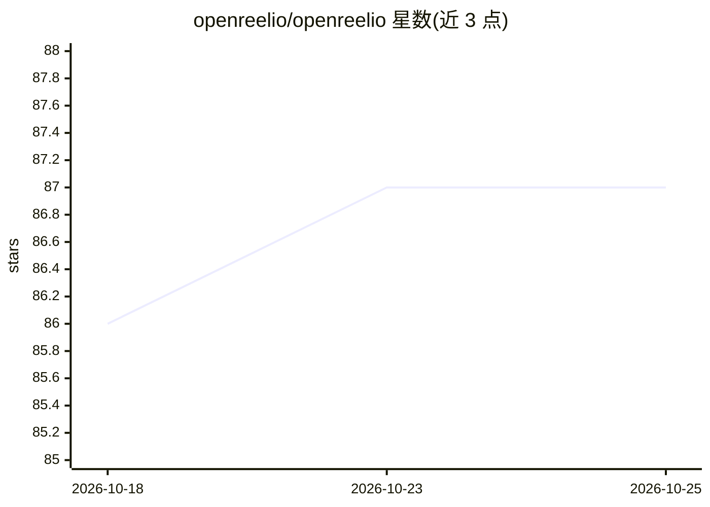

# openreelio/openreelio

⭐ 87 · Rust · MIT · 推送 2026-10-19 · [GitHub](https://github.com/openreelio/openreelio) · [官网](https://openreelio.com) · 组织维护

**面向内容创作者的 AI 桌面视频剪辑器，支持自然语言剪辑指令**

基于 Tauri 2.x + Rust 后端 + React 18 前端的开源桌面视频剪辑器，提供多轨非线性时间线、剪辑/特效/音频混音/字幕、GPU 加速编码（NVENC/AMF/QSV/VideoToolbox）等核心剪辑能力。AI 部分：自然语言剪辑指令、场景检测、Whisper 语音转文字（可选构建特性）、AI 剪辑建议；另提供 WASM 插件运行时、内置 QC 检查框架，以及供编码 Agent（Claude Code/Codex/Cursor）使用的 headless CLI 与 MCP 服务器。Windows/macOS/Linux 均有预构建安装包并捆绑 FFmpeg。

## 筛选速览

| 维度 | 判定 | 备注 |
|---|---|---|
| AI 角色 | `ai-enhanced` | 去掉 AI 部分产品仍成立 |
| 许可风险 | `permissive` | MIT |
| 部署形态 | `desktop` | 安装包/桌面程序 |
| 模型依赖 | — | README 未给出锁定关系 |
| 硬件要求 | — | 无带数字的原话,不猜 |
| 安装摩擦 | `medium` | 含编译或系统依赖之一 |
| 成熟度 | `idea` | |

## 能力要点

- 自然语言剪辑指令与 AI Agent 并行处理
- 多轨非线性时间线、特效转场、音频混音、字幕样式
- headless CLI 与 MCP 服务器，供编码 Agent 自主剪辑/分析/渲染视频
- GPU 加速编码（NVENC/AMF/QSV/VideoToolbox）与 WASM 插件运行时

## 适用场景

- 内容创作者剪辑短视频或长视频
- 通过自然语言描述完成剪辑操作
- 让 Claude Code 等编码 Agent 通过 MCP 自主进行视频剪辑与渲染

## 场景标签

`图像视频处理` `语音识别` · 领域:感知与多模态

## 证据(README 行号)

> L13: OpenReelio is an AI-powered desktop video editor designed for content creators. Built with a prompt-first approach,
> L26: - Non-linear timeline with multi-track support
> L128: OpenReelio ships a headless CLI and MCP server so coding agents (Claude Code, Codex, Cursor) can edit, analyze, re

## 星数曲线

2026-10-18 86 → 2026-10-25 87（+1）

---
*卡片 v1 · prompt 1.4 · 生成 2026-10-23 · 置信度 mid · 依据 README sha `1db8b6e42c48` · [字段定义](../../DATASET.md)*
