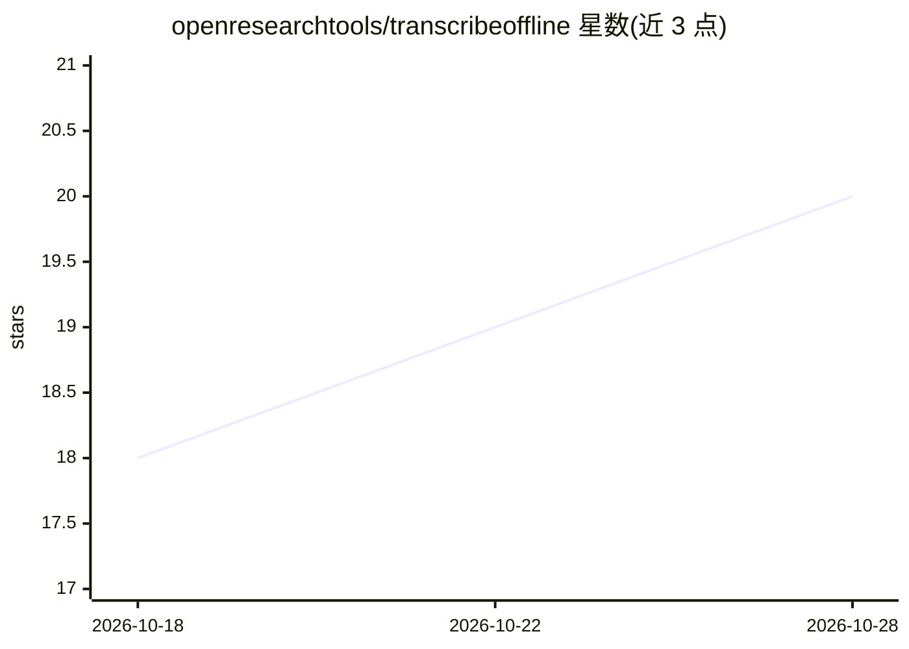

# openresearchtools/transcribeoffline

⭐ 20 · Rust · MIT · 推送 2026-09-22 · [GitHub](https://github.com/openresearchtools/transcribeoffline) · [官网](https://transcribeoffline.com/) · 个人维护

**完全离线的本地音频/视频转写桌面应用，支持说话人分离**

基于 Rust/egui 的原生桌面应用，通过 llama-server-bridge 调用 Openresearchtools-Engine 运行时，提供离线转写（speech/subtitle/transcript 三种输出）、实时流式转写与实时说话人分离（Voxtral 与 Sortformer 模型）、转录稿对照编辑、播放联动、说话人改名与匿名化处理，并可用本地 GGUF 模型做转录问答与匿名化抽取（beta）。Linux 版依赖 APT 安装的 Vulkan/CUDA 引擎包，未签名构建可能被系统安全策略拦截。

## 筛选速览

| 维度 | 判定 | 备注 |
|---|---|---|
| AI 角色 | `ai-native` | 本体是模型或模型工具 |
| 许可风险 | `permissive` | MIT |
| 部署形态 | `desktop` | 安装包/桌面程序 |
| 模型依赖 | local-ok | 支持本地模型 |
| 硬件要求 | — | 无带数字的原话,不猜 |
| 安装摩擦 | `medium` | 含编译或系统依赖之一 |
| 成熟度 | — | 结构信号不足 |

## 能力要点

- 完全离线的本地转写（Whisper GGML 模型）与字幕/转录稿输出
- 流式实时转写 + 实时说话人分离（Voxtral-Mini-4B / Sortformer 4spk）
- 本地 GGUF 聊天模型支持转录问答与匿名化抽取（beta）
- CUDA/Vulkan/Metal 加速，Linux 引擎经 APT 管理

## 适用场景

- 离线转写会议录音或访谈音频并区分说话人
- 生成与编辑字幕/转录稿并做敏感信息匿名化
- 不联网环境下处理敏感音频（需自行评估威胁模型）

## 场景标签

`语音识别` · 领域:感知与多模态

## 证据(README 行号)

> L5: **Transcribe Offline** is an open-source desktop app for local transcription,
> L6: speaker diarization, and transcript review/edit workflows.
> L62: ### 1) Local transcription modes
> L76: ### 4) Local LLM helpers

## 星数曲线

2026-10-18 18 → 2026-10-28 20（+2）

---
*卡片 v1 · prompt 1.4 · 生成 2026-10-28 · 置信度 high · 依据 README sha `f27f70ed6b0f` · [字段定义](../../DATASET.md)*
