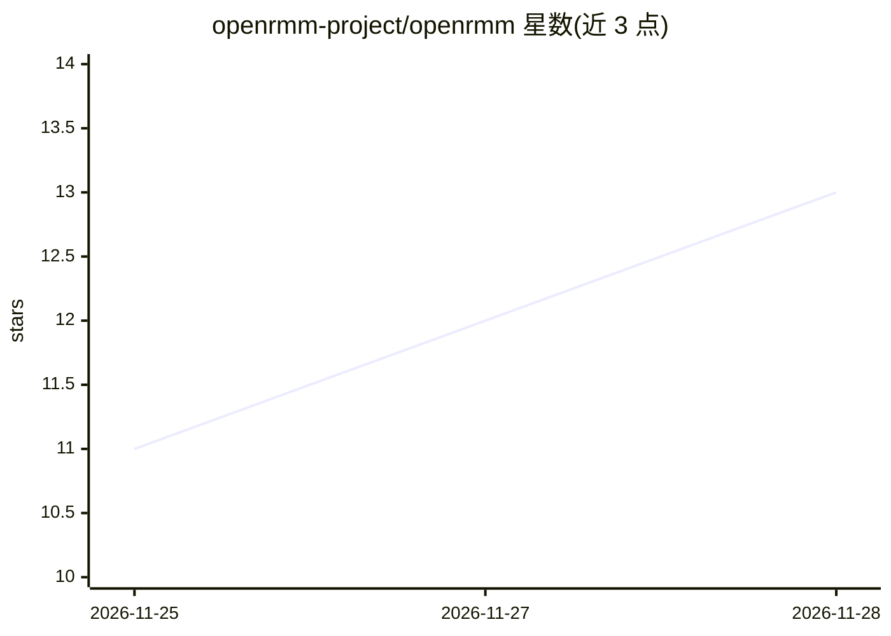

# openrmm-project/openrmm

⭐ 13 · Go · AGPL-3.0 · 推送 2026-11-27 · [GitHub](https://github.com/openrmm-project/openrmm) · [官网](https://openrmm.io) · 个人维护

**自托管开源 RMM：内置需人工审批的 AI 运维助手**

自托管的远程监控与管理（RMM）平台，提供 Go 编写的跨平台 agent（Windows/Linux/macOS，自更新）、可插拔远程访问（原生远程引擎、浏览器终端、MeshCentral、RustDesk）及经典 RMM 功能（Client→Site→Agent 层级、RBAC、脚本库、监控告警、计划任务、策略继承）。AI 部分：控制台聊天接入任意 OpenAI 兼容端点（含本地模型），模型读取设备状态并提议操作，所有变更类动作须经人工批准，带 dry-run 预览与 append-only 审计链；MCP server 允许 Claude/ChatGPT 等外部 AI 以同样的权限过滤与审批机制管理设备。九种语言的控制台翻译。部署用 Docker Compose，当前支持单服务器副本、无 HA。

## 筛选速览

| 维度 | 判定 | 备注 |
|---|---|---|
| AI 角色 | `ai-enhanced` | 去掉 AI 部分产品仍成立 |
| 许可风险 | `dual` | AGPL-3.0 |
| 部署形态 | `self-host` | docker 或自建部署 |
| 模型依赖 | local-ok | 支持本地模型 |
| 硬件要求 | — | 无带数字的原话,不猜 |
| 安装摩擦 | `low` | 无编译、无系统依赖或容器化 |
| 成熟度 | `idea` | |

## 能力要点

- AI 聊天采用 tool-calling 循环，所有变更动作需人工批准并记录审计链
- BYO 模型：任意 OpenAI 兼容端点（OpenAI、Ollama、vLLM 等）
- 自研 Go agent 单二进制跨平台，自服务端自更新
- MCP server 以 scoped token 或内置 OAuth 2.1 连接外部 AI

## 适用场景

- MSP/IT 团队自托管管理设备舰队且数据不出本地基础设施
- 用自然语言让 AI 提议批量运维脚本并人工审批后执行
- 通过 MCP 让外部 AI 助手安全接入设备管理流程
- 需要细粒度权限、2FA/SSO 与审计追溯的远程运维场景

## 场景标签

`AI 助手` · 领域:对话与助手

## 证据(README 行号)

> L3: An **open-source, self-hosted RMM** (Remote Monitoring & Management) with a
> L45: - **BYO AI model** — any OpenAI-compatible endpoint (OpenAI, Ollama, vLLM, …).
> L46: - **Classic RMM, too** — Client→Site→Agent hierarchy, RBAC users, script library

## 星数曲线

2026-11-25 11 → 2026-11-28 13（+2）

---
*卡片 v1 · prompt 1.4 · 生成 2026-11-24 · 置信度 high · 依据 README sha `e8670b46a40c` · [字段定义](../../DATASET.md)*
