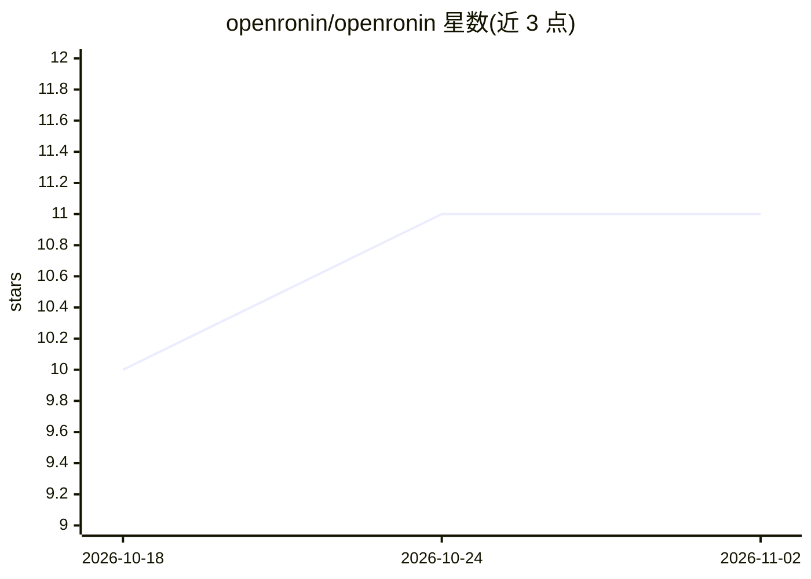

# openronin/openronin

⭐ 11 · TypeScript · MIT · 推送 2026-10-20 · [GitHub](https://github.com/openronin/openronin) · [官网](https://github.com/openronin/openronin) · 个人维护

**自托管 GitHub AI 开发队友：认领 issue、提交 PR、回复评审并自动合并**

自托管的 GitHub 守护进程，以远程开发者方式工作：按标签认领 issue、追问澄清、在隔离 worktree 中写代码并开 draft PR、回复评审评论并推送修复提交、自行 rebase 解决合并冲突，满足条件时可自动合并与部署。架构分 Supervisor（任意 OpenAI 兼容 API）与 Coder（现为 Claude Code）双层以控制成本；附 HTMX 管理 UI、MCP server、成本限额与 SQLite 备份。自述处于 Alpha，首次设置需手动编辑 .env 与 YAML。

## 筛选速览

| 维度 | 判定 | 备注 |
|---|---|---|
| AI 角色 | `ai-ecosystem` | LLM/agent 周边工具 |
| 许可风险 | `permissive` | MIT |
| 部署形态 | `library` | 以包/库形式分发 |
| 模型依赖 | local-ok | 支持本地模型 |
| 硬件要求 | — | 无带数字的原话,不猜 |
| 安装摩擦 | `low` | 无编译、无系统依赖或容器化 |
| 成熟度 | `idea` | |

## 能力要点

- Supervisor/Coder 双层引擎，Supervisor 兼容任意 OpenAI Chat Completions 协议 API
- 覆盖 triage/analyze/patch/pr_dialog/conflict_resolve/auto_merge/deploy 七条 lane
- 自带管理 UI（成本看板、任务下钻、审计日志）与 stdio MCP server
- 每任务/每日 USD 硬性成本熔断、崩溃恢复与暂停开关

## 适用场景

- 把明确范围的 bug 修复和小型改动交给 agent 以 issue→PR 流程完成
- 在自有服务器上运行替代交互式 AI 编码工具，代码不出本地
- 让 agent 处理 PR 评审评论、合并冲突等收尾工作

## 场景标签

`编码 Agent` · 领域:编码与开发

## 证据(README 行号)

> L7: File issues like you'd brief a remote developer. The agent picks them up, asks for clarification when it needs to, o
> L62: - **Supervisor:** any **OpenAI-compatible API**. We test against Xiaomi MIMO (cheap, ~$0.40 per 1M input tokens) an
> L63: - **Coder:** Claude Code today. OpenCode, Codex CLI, and direct-API coder modes are on the roadmap.

## 星数曲线

2026-10-18 10 → 2026-11-02 11（+1）

---
*卡片 v1 · prompt 1.4 · 生成 2026-11-01 · 置信度 mid · 依据 README sha `e6f9ff96fa2f` · [字段定义](../../DATASET.md)*
