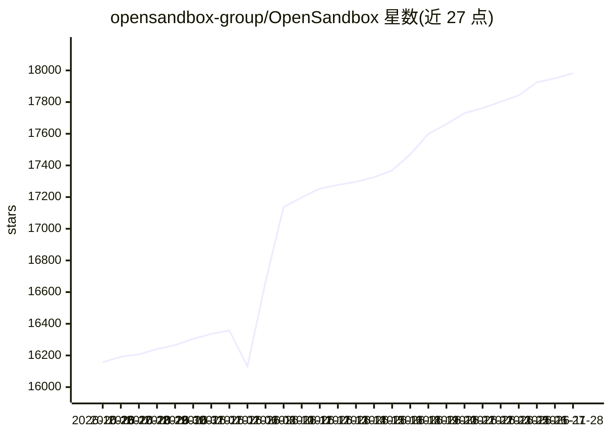

# opensandbox-group/OpenSandbox

⭐ 17,982 · Go · Apache-2.0 · 推送 2026-11-27 · [GitHub](https://github.com/opensandbox-group/OpenSandbox) · [官网](https://open-sandbox.ai) · 组织维护 · 中文 README

**AI agent 的隔离沙箱运行时：在自有基础设施上安全执行代码**

OpenSandbox 为 AI 应用提供隔离环境，用于执行代码、运行命令、管理文件及操作浏览器或桌面。本地以 Docker 启动，通过统一沙箱 API 部署到 Kubernetes；支持沙箱级出入站网络控制、凭据保险库（对外调用不暴露真实凭据）、资源池与批量创建（面向评测与 RL 训练负载）。提供 Python/Java/Kotlin/TS/C#/Go 多语言 SDK、osb CLI、MCP server，以及可扩展的沙箱生命周期与执行协议。项目隶属 Agentic AI Foundation，Apache 2.0 许可。

## 筛选速览

| 维度 | 判定 | 备注 |
|---|---|---|
| AI 角色 | `ai-ecosystem` | LLM/agent 周边工具 |
| 许可风险 | `permissive` | Apache-2.0 |
| 部署形态 | `library` | 以包/库形式分发 |
| 模型依赖 | — | README 未给出锁定关系 |
| 硬件要求 | — | 无带数字的原话,不猜 |
| 安装摩擦 | `medium` | 含编译或系统依赖之一 |
| 成熟度 | — | 结构信号不足 |

## 动量与使用信号

- 维护:`active` — 距上次 push 1.3 天,年发版 100,142 位贡献者
- 涨星:近 1 天 **+35**(自 20261016 起算)
- 安装:pypi 包 `opensandbox` 月下载 497,515
- 平台:— · 协议:MCP

## 能力要点

- Kubernetes 上高密度沙箱运行时，支持 Firecracker 沙箱暂停/恢复并保留内存与磁盘状态
- 统一沙箱 API：本地 Docker 到集群部署同一生命周期接口
- 凭据保险库使 agent 调用外部服务时不暴露真实凭据
- 多语言 SDK、osb CLI 与 MCP server 三种接入方式

## 适用场景

- 在隔离环境中运行编码 agent 完成文件编辑与命令执行
- 通过 Code Interpreter 执行模型生成的代码做数据分析
- 为 agent 评测提供每试验独立沙箱
- 自动化浏览器与桌面交互任务

## 场景标签

`数据分析` `模型评测` · 领域:效率与自动化

## 证据(README 行号)

> L18: **Run AI agents in sandboxes on your own infrastructure.**
> L20: OpenSandbox gives AI applications isolated environments to execute code, run commands, manage files, and operate br
> L33: |**SDKs, CLI, and MCP**|Integrate with Python, Java/Kotlin, TypeScript/JavaScript, C#/.NET, or Go SDKs. Use `osb` f

## 星数曲线

2026-10-26 16,157 → 2026-11-28 17,982（+1,825）

---
*卡片 v1 · prompt 1.4 · 生成 2026-11-22 · 置信度 high · 依据 README sha `cd5a1a129d08` · [字段定义](../../DATASET.md)*
