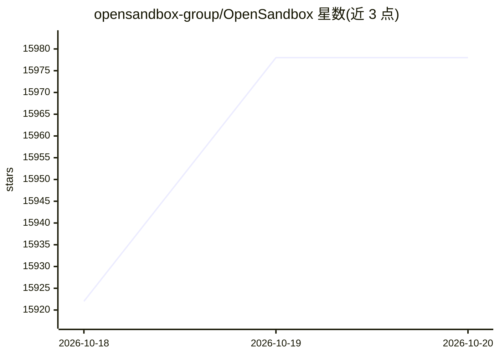

# opensandbox-group/OpenSandbox

⭐ 15,978 · Python · Apache-2.0 · 推送 2026-10-19 · [GitHub](https://github.com/opensandbox-group/OpenSandbox) · [官网](https://open-sandbox.ai) · 组织维护 · 中文 README

**在自有基础设施上运行 AI agent 的沙箱运行时**

OpenSandbox 为 AI 应用提供隔离执行环境，支持代码执行、命令运行、文件管理以及浏览器/桌面操作。本地可用 Docker 启动，部署到 Kubernetes 通过统一沙箱 API 管理。提供 Python、Java/Kotlin、TypeScript/JavaScript、C#/.NET、Go 多语言 SDK，附带 `osb` CLI 与 MCP server，支持流量入口网关、出站 egress 策略、凭据保管（Credential Vault），以及 Firecracker 沙箱的暂停/恢复，资源池与批量创建面向 agent 评估与 RL 训练负载。Apache 2.0 开源。

## 筛选速览

| 维度 | 判定 | 备注 |
|---|---|---|
| AI 角色 | `ai-ecosystem` | LLM/agent 周边工具 |
| 许可风险 | `permissive` | Apache-2.0 |
| 部署形态 | `library` | 以包/库形式分发 |
| 模型依赖 | — | README 未给出锁定关系 |
| 硬件要求 | — | 无带数字的原话,不猜 |
| 安装摩擦 | `medium` | 含编译或系统依赖之一 |
| 成熟度 | — | 结构信号不足 |

## 动量与使用信号

- 维护:`active` — 距上次 push 1.3 天,年发版 100,142 位贡献者
- 涨星:近 1 天 **+35**(自 20261016 起算)
- 安装:pypi 包 `opensandbox` 月下载 497,515
- 平台:— · 协议:MCP

## 能力要点

- 多语言 SDK（Python/Java/TS/C#/Go）、CLI 与 MCP 三种接入方式
- Firecracker 沙箱支持暂停/恢复并保留内存与磁盘状态
- 入站统一 ingress 网关与按沙箱出站 egress 策略
- 官方镜像发布于 Docker Hub/ghcr/阿里云三个镜像仓库，Cosign 签名

## 适用场景

- 为 coding agent 提供隔离的文件编辑与命令执行环境
- 运行模型生成代码并做数据分析（Code Interpreter SDK）
- 给 agent 提供浏览器或桌面自动化环境
- 为 agent 评估与 RL 训练批量创建独立沙箱

## 场景标签

 · 领域:AI 基础设施/沙箱运行时

## 证据(README 行号)

> L17: **Run AI agents in sandboxes on your own infrastructure.**
> L19: OpenSandbox gives AI applications isolated environments to execute code, run commands, manage files, and operate br
> L32: |**SDKs, CLI, and MCP**|Integrate with Python, Java/Kotlin, TypeScript/JavaScript, C#/.NET, or Go SDKs. Use `osb` f

## 星数曲线

2026-10-18 15,922 → 2026-10-20 15,978（+56）

---
*卡片 v1 · prompt 1.4 · 生成 2026-10-18 · 置信度 high · 依据 README sha `35e426993254` · [字段定义](../../DATASET.md)*
