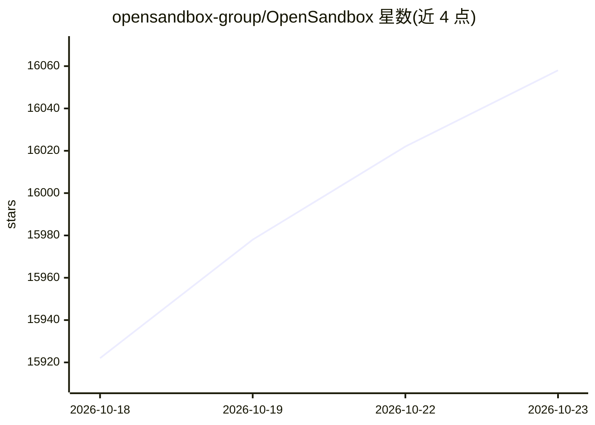

# opensandbox-group/OpenSandbox

⭐ 16,058 · Python · Apache-2.0 · 推送 2026-10-22 · [GitHub](https://github.com/opensandbox-group/OpenSandbox) · [官网](https://open-sandbox.ai) · 组织维护 · 中文 README

**面向 AI agent 的沙箱运行时：自建基础设施上隔离执行代码**

为 AI 应用提供隔离执行环境的沙箱运行时：agent 可在沙箱内执行命令、运行代码、管理文件及操作浏览器/桌面。本地以 Docker 启动，集群部署于 Kubernetes，提供统一沙箱 API。基于 Firecracker 的快速沙箱支持暂停/恢复，具备入口网关、逐沙箱出网策略与凭证保险库。提供 Python/Java/TS/C#/Go SDK、CLI（osb）与 MCP 服务器。本地运行要求 Docker 与 Python 3.10+。

## 筛选速览

| 维度 | 判定 | 备注 |
|---|---|---|
| AI 角色 | `ai-ecosystem` | LLM/agent 周边工具 |
| 许可风险 | `permissive` | Apache-2.0 |
| 部署形态 | `library` | 以包/库形式分发 |
| 模型依赖 | — | README 未给出锁定关系 |
| 硬件要求 | — | 无带数字的原话,不猜 |
| 安装摩擦 | `medium` | 含编译或系统依赖之一 |
| 成熟度 | — | 结构信号不足 |

## 动量与使用信号

- 维护:`active` — 距上次 push 1.3 天,年发版 100,142 位贡献者
- 涨星:近 1 天 **+35**(自 20261016 起算)
- 安装:pypi 包 `opensandbox` 月下载 497,515
- 平台:— · 协议:MCP

## 能力要点

- Firecracker 沙箱创建 64ms P50，支持暂停/恢复保留内存与磁盘状态
- 统一入口网关与逐沙箱出网策略、凭证保险库
- 本地 Docker 与 Kubernetes 集群统一生命周期 API
- 5 种语言 SDK、CLI 与 MCP 服务器

## 适用场景

- 在隔离环境中运行编码 agent 执行命令与编辑文件
- 执行模型生成的代码并处理结果
- 为 agent 评测或 RL 训练批量创建沙箱
- 给 agent 提供浏览器/桌面自动化环境

## 场景标签

 · 领域:AI 基础设施/容器沙箱

## 证据(README 行号)

> L17: **Run AI agents in sandboxes on your own infrastructure.**
> L19: OpenSandbox gives AI applications isolated environments to execute code, run commands, manage files, and operate br
> L32: |**SDKs, CLI, and MCP**|Integrate with Python, Java/Kotlin, TypeScript/JavaScript, C#/.NET, or Go SDKs. Use `osb` f

## 星数曲线

2026-10-18 15,922 → 2026-10-23 16,058（+136）

---
*卡片 v1 · prompt 1.4 · 生成 2026-10-20 · 置信度 high · 依据 README sha `420884b5cc47` · [字段定义](../../DATASET.md)*
