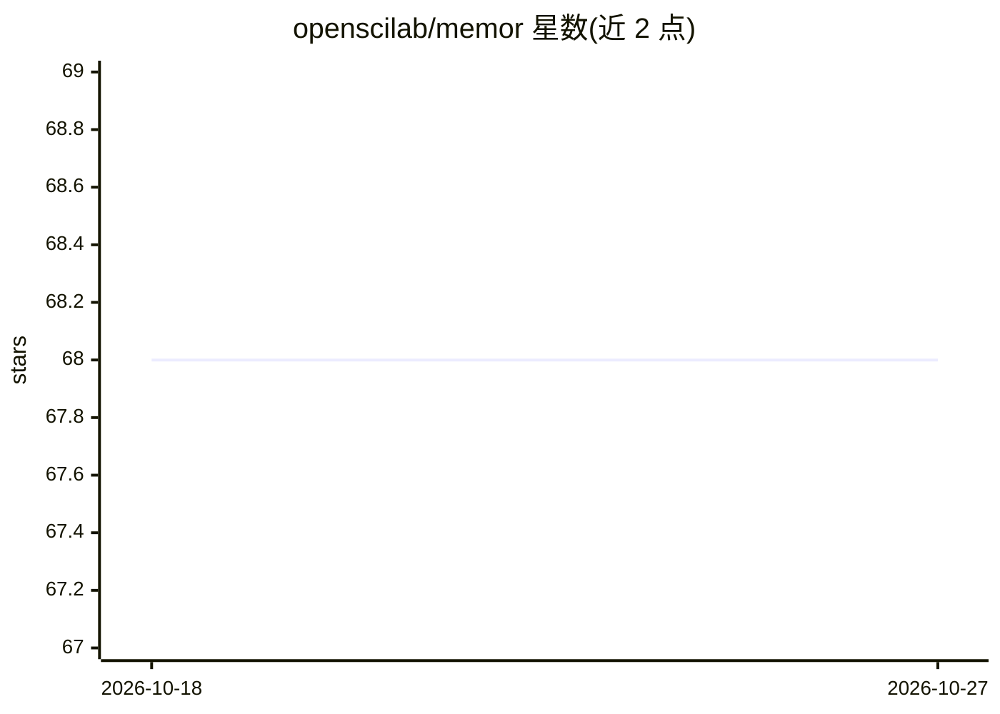

# openscilab/memor

⭐ 68 · Python · MIT · 推送 2026-10-26 · [GitHub](https://github.com/openscilab/memor) · 组织维护

**面向开发者的 LLM 对话结构化记忆库：可复现地保存与迁移会话**

Python 库，将用户提示与模型回答抽象为 Prompt/Response/Session 三层结构，保存对话内容及温度、token 数、模型、seed、推理时间等元数据，形成可复现的结构化日志。采用模型无关设计，可在不同 LLM 间保持上下文切换与迁移会话片段。提供 PromptTemplate 模板类（支持 FORMAT/JINJA 引擎、版本化与 JSON 持久化）及预设模板集，用于将历史对话渲染为新提示注入上下文。通过 pip 安装，README 示例搭配 Mistral 使用。

## 筛选速览

| 维度 | 判定 | 备注 |
|---|---|---|
| AI 角色 | `ai-ecosystem` | LLM/agent 周边工具 |
| 许可风险 | `permissive` | MIT |
| 部署形态 | `library` | 以包/库形式分发 |
| 模型依赖 | — | README 未给出锁定关系 |
| 硬件要求 | — | 无带数字的原话,不猜 |
| 安装摩擦 | `low` | 无编译、无系统依赖或容器化 |
| 成熟度 | — | 结构信号不足 |

## 能力要点

- Prompt/Response/Session 三层抽象，记录温度、token、seed、推理时间等元数据
- 模型无关设计，支持跨 LLM 保持上下文切换与选择性迁移会话片段
- PromptTemplate 支持版本化、Jinja 引擎与 JSON 持久化
- 提供预设模板集将历史对话渲染注入新提示

## 适用场景

- 保存可复现的 LLM 对话日志并随时回顾
- 跨模型迁移会话上下文（如检索用一模型、推理换另一模型）
- 在 prompt 工程中管理与复用结构化提示模板

## 场景标签

`提示工程` `Agent 记忆` · 领域:Agent 开发

## 证据(README 行号)

> L2:  Memor: Reproducible Structured Memory for LLMs
> L15: Because of the model-agnostic design, users can begin a conversation with one LLM and switch to another keeping the
> L18: Memor also lets users select, filter, and then share the specific parts of the past conversations across different 

## 星数曲线

2026-10-18 68 → 2026-10-27 68（+0）

---
*卡片 v1 · prompt 1.4 · 生成 2026-10-24 · 置信度 high · 依据 README sha `e67a37af0c5c` · [字段定义](../../DATASET.md)*
