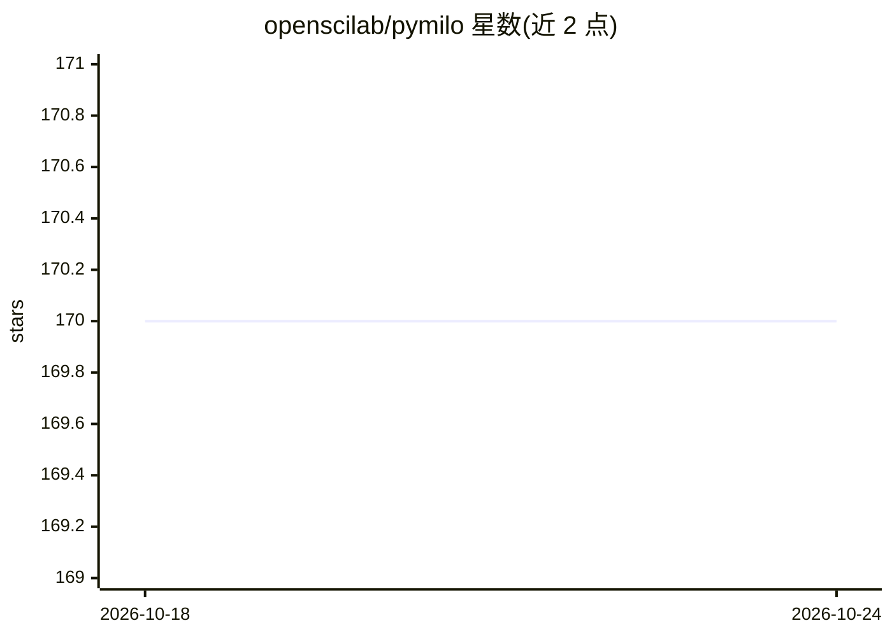

# openscilab/pymilo

⭐ 170 · Python · MIT · 推送 2026-10-19 · [GitHub](https://github.com/openscilab/pymilo) · 组织维护

**把训练好的 ML 模型透明导出为 JSON 的 Python 库**

PyMilo 是用于机器学习模型输入/输出的开源 Python 包：将 scikit-learn 训练的模型（线性模型、神经网络、树、聚类、SVM、集成、Pipeline、预处理等 13 类）序列化为透明 JSON 文件，可跨平台传输与共享，规避 pickle 等二进制格式的安全风险；通过 Import 类从文件、JSON 字符串或 URL 恢复模型。另提供 ML streaming 功能，以 REST/WebSocket 协议在远程服务器上服务模型（该功能自述尚未稳定，需安装 streaming 模式）。面向需要模型导出、部署与远程调用的开发者。

## 筛选速览

| 维度 | 判定 | 备注 |
|---|---|---|
| AI 角色 | `ai-ecosystem` | LLM/agent 周边工具 |
| 许可风险 | `permissive` | MIT |
| 部署形态 | `library` | 以包/库形式分发 |
| 模型依赖 | — | README 未给出锁定关系 |
| 硬件要求 | — | 无带数字的原话,不猜 |
| 安装摩擦 | `low` | 无编译、无系统依赖或容器化 |
| 成熟度 | `idea` | |

## 能力要点

- scikit-learn 13 类模型导出为透明 JSON 并可完整还原
- 支持从文件、JSON 字符串、URL 导入模型
- ML streaming：REST/WebSocket 远程服务模型，支持 GZIP/ZLIB/LZMA/BZ2 压缩
- 批量导入导出（batch_export/batch_import）

## 适用场景

- 把训练好的 scikit-learn 模型安全地分享或跨环境迁移
- 以透明可审查的 JSON 替代 pickle 存储模型
- 在远程服务器部署模型并通过客户端调用 predict

## 场景标签

`MLOps` `推理引擎` · 领域:训练与推理

## 证据(README 行号)

> L10: PyMilo is an open source Python package that provides a simple, efficient, and safe way for users to export pre-tra
> L237: |scikit-learn|PyTorch|

## 星数曲线

2026-10-18 170 → 2026-10-24 170（+0）

---
*卡片 v1 · prompt 1.4 · 生成 2026-10-22 · 置信度 high · 依据 README sha `86499a43a775` · [字段定义](../../DATASET.md)*
