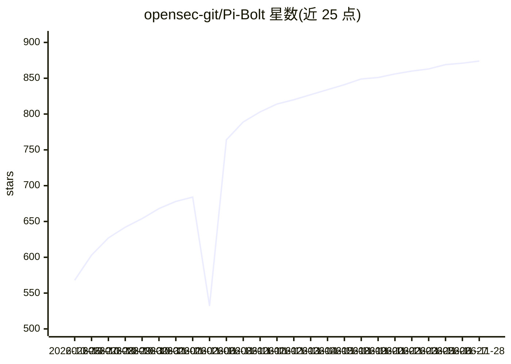

# opensec-git/Pi-Bolt

⭐ 874 · TypeScript · MIT · 推送 2026-11-27 · [GitHub](https://github.com/opensec-git/Pi-Bolt) · [官网](https://pi-bolt.opensec.in) · 组织维护

**Pi 编码 agent 的 AOT 原生编译发行版，无需 Node/Bun**

将 Pi 编码 agent 预先编译为单一原生可执行文件，保留 Pi 的命令、会话、设置、providers 与扩展兼容性，启动时无需解析或 JIT 编译。README 给出与 Node 24 及 Bun 版 Pi 的启动耗时、CPU 与内存对比数据。提供 curl/PowerShell 安装脚本、Homebrew、Scoop、mise、npm、AUR 等安装途径，支持 Linux x86-64/ARM64、macOS Apple silicon、Windows x64 与 Termux。重负载扩展可切换 JIT 构建，或用 `pi-bolt compile` 将插件编译进可执行文件。

## 筛选速览

| 维度 | 判定 | 备注 |
|---|---|---|
| AI 角色 | `ai-ecosystem` | LLM/agent 周边工具 |
| 许可风险 | `permissive` | MIT |
| 部署形态 | `desktop` | 安装包/桌面程序 |
| 模型依赖 | — | README 未给出锁定关系 |
| 硬件要求 | — | 无带数字的原话,不猜 |
| 安装摩擦 | `low` | 无编译、无系统依赖或容器化 |
| 成熟度 | — | 结构信号不足 |

## 能力要点

- 单一原生可执行文件，运行无需 Node.js、Bun 或 npm
- 与 Pi 共享 `~/.pi/agent` 配置，扩展原样可用
- 可通过 `--acp` 接入 Zed/JetBrains/VS Code 等 ACP 编辑器，通过 `--mcp` 作为 MCP 服务器
- 提供 JIT 变体与 `pi-bolt compile` 编译插件机制

## 适用场景

- 在无 Node.js 环境的机器上运行 Pi 编码 agent
- 在 Android Termux 中使用编码 agent
- 把编码 agent 作为 MCP 服务器交给其他 agent 调用
- 在编辑器 agent 面板中使用 Pi 配置与扩展

## 场景标签

`编码 Agent` · 领域:编码与开发

## 证据(README 行号)

> L7:  The Pi coding agent, compiled ahead of time to native code.
> L36: Pi-Bolt is the Pi you already use, with the same commands, sessions, settings, providers and extensions, but every 
> L60: - **The same Pi:** same commands, sessions, settings and providers; every Pi extension works unchanged.

## 星数曲线

2026-10-26 568 → 2026-11-28 874（+306）

---
*卡片 v1 · prompt 1.4 · 生成 2026-11-26 · 置信度 high · 依据 README sha `b9d21fc77d78` · [字段定义](../../DATASET.md)*
