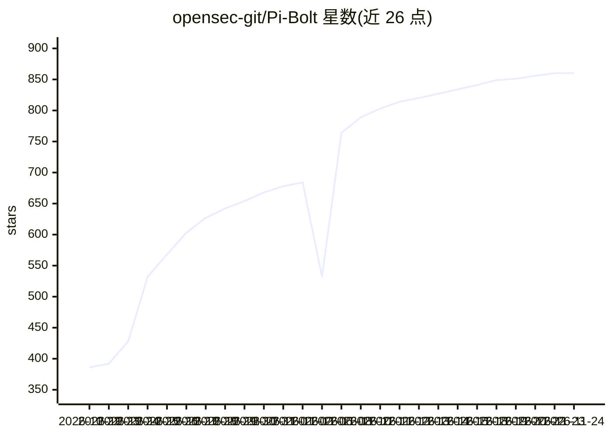

# opensec-git/Pi-Bolt

⭐ 863 · TypeScript · MIT · 推送 2026-11-22 · [GitHub](https://github.com/opensec-git/Pi-Bolt) · [官网](https://pi-bolt.opensec.in) · 组织维护

**把 Pi 编码 agent 编译为单个原生可执行文件，免 Node 运行**

Pi-Bolt 是 Pi 编码 agent 的提前编译（AOT）版本：将 Pi 编译为覆盖 Linux x86-64/ARM64、macOS Apple silicon、Windows x64 与 Android Termux 的单文件原生可执行程序，启动、流式响应 CPU、会话内存等基准数据均与 Node/Bun 版 Pi 对比给出。沿用 Pi 的命令、会话、设置、provider 与扩展（~/.pi/agent 配置直接复用），可与 Pi 并存。默认构建无 JIT，运行时加载的扩展被解释执行，提供 JIT 构建与 `pi-bolt compile` 把扩展编译进可执行文件。安装途径含 curl/PowerShell 脚本、Homebrew、Scoop、mise、npm、AUR。

## 筛选速览

| 维度 | 判定 | 备注 |
|---|---|---|
| AI 角色 | `ai-ecosystem` | LLM/agent 周边工具 |
| 许可风险 | `permissive` | MIT |
| 部署形态 | `desktop` | 安装包/桌面程序 |
| 模型依赖 | — | README 未给出锁定关系 |
| 硬件要求 | — | 无带数字的原话,不猜 |
| 安装摩擦 | `low` | 无编译、无系统依赖或容器化 |
| 成熟度 | — | 结构信号不足 |

## 能力要点

- 提前编译为单文件原生可执行程序，无需 Node.js、Bun 或 npm
- 复用 Pi 的命令、会话、设置、providers 与扩展，可与 Pi 并存安装
- 内置 grep/find 进程内搜索工具，可被 pi-fff 扩展替换
- 可作为 ACP 编辑器面板（Zed/JetBrains/VS Code/Neovim）运行，也可作为 MCP server 被其他 agent 调用

## 适用场景

- 在没有 Node/Bun 环境的机器上直接运行 Pi 编码 agent
- 在 Zed、JetBrains 等 ACP 编辑器的 agent 面板中使用编码 agent
- 在 Android Termux 上运行编码 agent
- 把常用扩展编译进可执行文件以消除运行时解释开销

## 场景标签

`编码 Agent` · 领域:编码与开发

## 证据(README 行号)

> L7:  The Pi coding agent, compiled ahead of time to native code.
> L60: - **The same Pi:** same commands, sessions, settings and providers; every Pi extension works unchanged.
> L195: - **Other agents:** `pi-bolt --mcp` is an MCP server; other agents give Pi-Bolt a task with

## 星数曲线

2026-10-22 386 → 2026-11-24 860（+474）

---
*卡片 v1 · prompt 1.4 · 生成 2026-11-24 · 置信度 high · 依据 README sha `c8586a39e8c6` · [字段定义](../../DATASET.md)*
