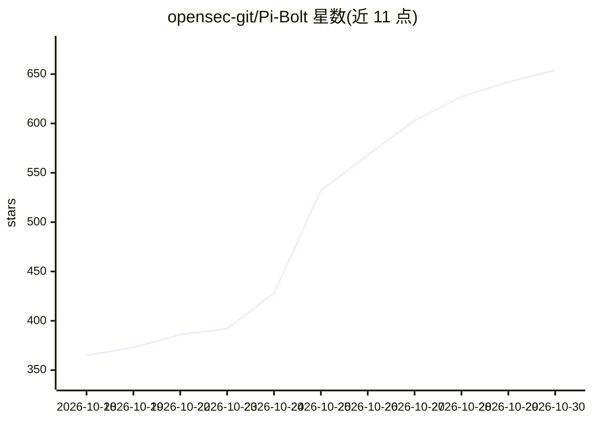

# opensec-git/Pi-Bolt

⭐ 654 · TypeScript · MIT · 推送 2026-10-28 · [GitHub](https://github.com/opensec-git/Pi-Bolt) · [官网](https://pi-bolt.opensec.in) · 组织维护

**Pi 编程代理的 AOT 原生编译分发版，单可执行文件启动**

Pi-Bolt 是 Pi coding agent 的独立 fork，将 Pi 连同 Bun 运行时通过 bun build 编译为 JavaScriptCore 字节码，再由 AOT 编译器把每个函数编译为 x86-64/ARM64 机器码，打包为单个可执行文件，无需 Node.js 或 Bun。命令、会话、设置、providers 与扩展与 Pi 保持一致，扩展可原样运行或用 pi-bolt compile 编译进可执行文件。提供 curl 安装脚本、npm/bun 安装、AUR 包与手动下载；支持 Linux x86-64/ARM64、macOS Apple silicon、Windows x64 及 Termux。限制：musl 不支持，默认构建无 JIT（重度插件需 JIT 构建）。

## 筛选速览

| 维度 | 判定 | 备注 |
|---|---|---|
| AI 角色 | `ai-native` | 本体是模型或模型工具 |
| 许可风险 | `permissive` | MIT |
| 部署形态 | `desktop` | 安装包/桌面程序 |
| 模型依赖 | — | README 未给出锁定关系 |
| 硬件要求 | — | 无带数字的原话,不猜 |
| 安装摩擦 | `low` | 无编译、无系统依赖或容器化 |
| 成熟度 | — | 结构信号不足 |

## 能力要点

- 单可执行文件内置 Bun 运行时与预构建堆，无 JIT、无 Node/Bun 依赖
- 与 Pi 共享 ~/.pi/agent 配置，扩展原样兼容，可编译进可执行文件
- 支持 ACP 编辑器接入（Zed/JetBrains/VS Code/Neovim）与 MCP server 模式
- pi-bolt doctor 输出安装诊断报告，pi-bolt update 支持回滚与 beta 通道

## 适用场景

- 想要更快启动、更低 CPU/内存的 Pi coding agent 使用者
- 在 Zed、JetBrains 等 ACP 编辑器代理面板中运行 Pi
- 在 Termux/Android 或树莓派等 ARM64 设备上本地运行编程代理
- 让其他 agent 通过 MCP 调用 Pi-Bolt 执行任务

## 场景标签

`编码 Agent` · 领域:编码与开发

## 证据(README 行号)

> L18:  The Pi coding agent, compiled ahead of time to native code.
> L21: Pi-Bolt is the Pi you already use, with the same commands, sessions, settings, providers and extensions. Every func

## 星数曲线

2026-10-18 365 → 2026-10-30 654（+289）

---
*卡片 v1 · prompt 1.4 · 生成 2026-10-21 · 置信度 high · 依据 README sha `d8a919f9ee7d` · [字段定义](../../DATASET.md)*
