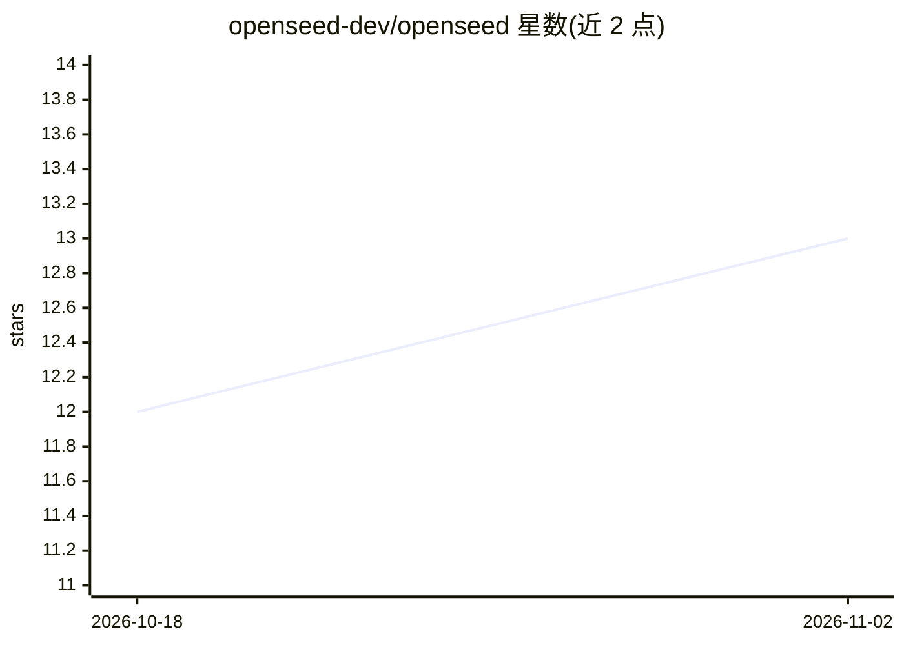

# openseed-dev/openseed

⭐ 13 · TypeScript · MIT · 推送 2026-03-17 · [GitHub](https://github.com/openseed-dev/openseed) · [官网](https://openseed.dev) · 组织维护

**自主 AI creature 运行框架：在 Docker 中持续运行并自我改写代码**

一个用 TypeScript 编写的自主 AI agent 运行框架：每个 creature 是一个长期运行在 Docker 容器中的进程，读取 PURPOSE.md 后自主思考与行动，具备睡眠时的记忆固化（observations/rules）、梦境自省、每 10 次睡眠触发的自我评估并改写自身源码等机制。宿主侧提供 orchestrator（Docker 容器生命周期管理、健康检查、回滚）、Web dashboard（SSE 实时事件流）、LLM 转换代理（路由 Anthropic/OpenAI，强制每 creature 日花费上限）与 CLI。通过 genome 定义认知架构（默认 dreamer 与 minimal 两种），支持从 GitHub 安装社区 genome。需要 Docker 与至少一个 API key。

## 筛选速览

| 维度 | 判定 | 备注 |
|---|---|---|
| AI 角色 | `ai-ecosystem` | LLM/agent 周边工具 |
| 许可风险 | `permissive` | MIT |
| 部署形态 | `self-host` | docker 或自建部署 |
| 模型依赖 | locked-api |  |
| 硬件要求 | — | 无带数字的原话,不猜 |
| 安装摩擦 | `low` | 无编译、无系统依赖或容器化 |
| 成熟度 | — | 结构信号不足 |

## 能力要点

- creature 在 Docker 容器中持续自主运行，git log 记录每次自我修改
- 三层记忆系统：上下文、observations 固化、全量对话日志（rg 可检索）
- LLM 转换代理：按模型路由 Anthropic/OpenAI 并执行每日花费上限（默认 $20/天）
- genome 机制定义认知架构，支持 seed genome install 安装社区 genome

## 适用场景

- 运行监控论文/repo 并输出日报的研究 agent
- 部署看护基础设施、响应告警的 DevOps creature
- 观察给定最小 genome 后 agent 的涌现行为
- 自定义 genome 构建特定认知架构的自主 agent

## 场景标签

`Agent 框架` `Agent 记忆` · 领域:Agent 开发

## 证据(README 行号)

> L6: Autonomous AI creatures that live in Docker containers. They think, act, sleep, dream, and modify their own code -- 
> L194: ├── LLM proxy - routes to Anthropic or OpenAI based on model
> L200: **LLM Proxy** - creatures call the proxy instead of the LLM provider directly. The proxy detects the model, inject

## 星数曲线

2026-10-18 12 → 2026-11-02 13（+1）

---
*卡片 v1 · prompt 1.4 · 生成 2026-11-01 · 置信度 mid · 依据 README sha `cb2acf6296e6` · [字段定义](../../DATASET.md)*
