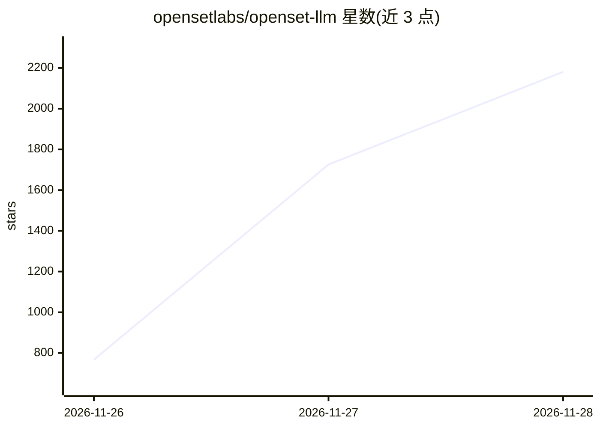

# opensetlabs/openset-llm

⭐ 2,181 · Python · MIT · 推送 2026-11-27 · [GitHub](https://github.com/opensetlabs/openset-llm) · 组织维护

**无GPU用户：8GB内存CPU上本地运行LLM推理引擎**

面向普通 x86 CPU 的 LLM 推理引擎：无需 GPU、8 GB 内存下运行 27B 三值量化模型（5.95 GB 文件），提供 OpenAI 兼容 API 与本地聊天页面。技术途径为重写 matmul 内核、投机解码、注意力与缓存等运行时层，基于 PrismML 的 llama.cpp fork 打补丁。安装途径包括一键脚本（预编译引擎）、源码编译（需 git/cmake/C++ 编译器）和 Docker 镜像；要求 Linux 或 WSL2、AVX-512 或 AVX2。MIT 许可。

## 筛选速览

| 维度 | 判定 | 备注 |
|---|---|---|
| AI 角色 | `ai-ecosystem` | LLM/agent 周边工具 |
| 许可风险 | `permissive` | MIT |
| 部署形态 | `self-host` | docker 或自建部署 |
| 模型依赖 | local-ok | 支持本地模型 |
| 硬件要求 | `cpu-ok` | |
| 安装摩擦 | `low` | 无编译、无系统依赖或容器化 |
| 成熟度 | — | 结构信号不足 |

## 能力要点

- 8 GB 内存、无 GPU 运行 27B 三值量化模型
- 提供 OpenAI 兼容 API，现有客户端与 agent 可直接使用
- 支持 AVX-512 与 AVX2（256-bit 内核）两类 CPU
- 一键脚本安装预编译引擎，另提供 Docker 镜像与源码编译

## 适用场景

- 在无 GPU 的笔记本或云主机上本地运行大模型对话
- 为已有 OpenAI 兼容客户端和 agent 提供本地推理后端
- 本地搜索、抽取、agent、语音等场景的离线推理，无按 token 计费

## 场景标签

`推理引擎` `模型量化` · 领域:训练与推理

## 证据(README 行号)

> L62: openset-llm is an inference engine for ordinary CPUs; more models and more hardware will follow. Today it runs
> L65: serves an OpenAI-compatible API, so the clients and agents you already use work unchanged.
> L107: **For developers.** The same server speaks the OpenAI API, so existing clients and agents work unchanged.

## 星数曲线

2026-11-26 767 → 2026-11-28 2,181（+1,414）

---
*卡片 v1 · prompt 1.4 · 生成 2026-11-28 · 置信度 mid · 依据 README sha `5df87e196798` · [字段定义](../../DATASET.md)*
