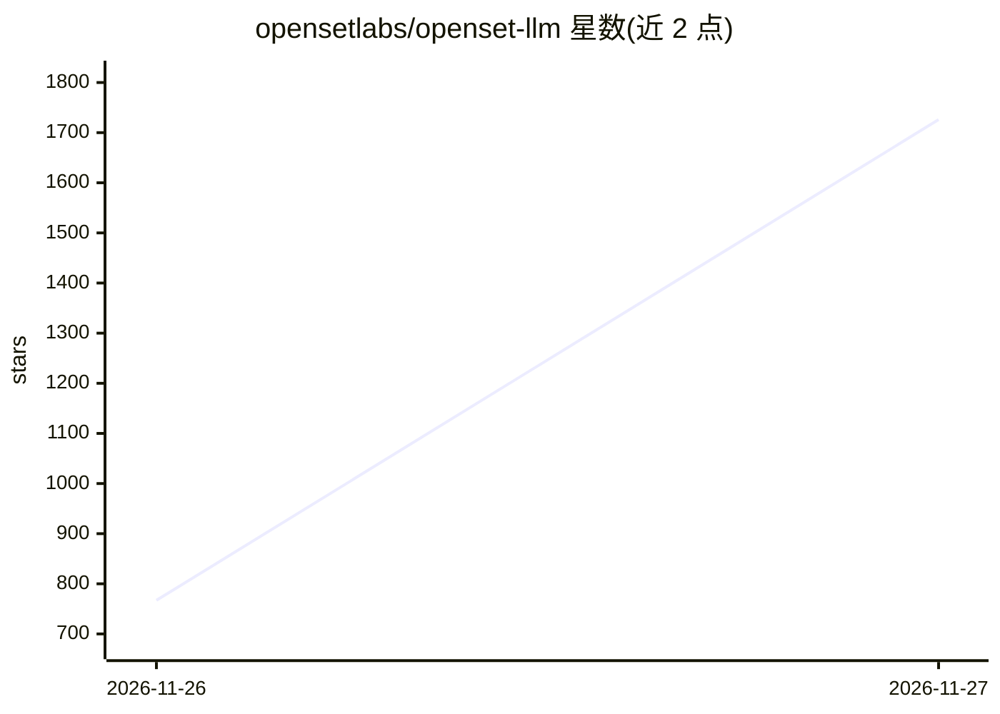

# opensetlabs/openset-llm

⭐ 1,726 · C++ · MIT · 推送 2026-11-26 · [GitHub](https://github.com/opensetlabs/openset-llm) · 组织维护

**面向普通 CPU 的本地 LLM 推理引擎，无需 GPU、8 GB 内存可跑**

基于 PrismML 的 llama.cpp 分支重写的推理引擎，提供新内核与运行时补丁，当前运行 Qwen3.8-27B（三元权重 5.95 GB，PrismML Bonsai-2-27B）。通过 ./start 或 ./serve 脚本从源码构建并下载模型，默认开启投机解码，输出 OpenAI 兼容 API（/v1），自带聊天页面，支持多请求并发（--multi）。要求 Linux/WSL2、x86-64 CPU（AVX-512 最快，AVX2 走 256-bit 内核）、8 GB 内存，构建需 git/cmake/C++ 编译器。README 附多轮基准数据与质量测试（GSM8K、HumanEval/MBPP）。

## 筛选速览

| 维度 | 判定 | 备注 |
|---|---|---|
| AI 角色 | `ai-ecosystem` | LLM/agent 周边工具 |
| 许可风险 | `permissive` | MIT |
| 部署形态 | `self-host` | docker 或自建部署 |
| 模型依赖 | — | README 未给出锁定关系 |
| 硬件要求 | `cpu-ok` | |
| 安装摩擦 | `low` | 无编译、无系统依赖或容器化 |
| 成熟度 | — | 结构信号不足 |

## 能力要点

- 在 8 vCPU/8 GB 纯 CPU 机器上以 17–20 tok/s 解码 27B 模型
- OpenAI 兼容 API，现有客户端与 agent 无需改动即可接入
- 多请求并发模式（--multi 4），并提供 CPU/RAM 检查脚本 install.sh --check
- README 提供与其他引擎的配对基准、长上下文与 agent 步进耗时数据

## 适用场景

- 在没有 GPU 的普通服务器或云主机上本地跑大模型
- 为已有 OpenAI 客户端代码提供本地推理后端
- 在受限内存（8 GB）环境运行 27B 级别模型
- 本地运行搜索、信息抽取、agent 循环等任务，不产生按 token 计费

## 场景标签

`推理引擎` · 领域:训练与推理

## 证据(README 行号)

> L14:  API: OpenAI-compatible
> L49: openset-llm is an inference engine for ordinary CPUs; more models and more hardware will follow. Today it runs
> L52: serves an OpenAI-compatible API, so the clients and agents you already use work unchanged.

## 星数曲线

2026-11-26 767 → 2026-11-27 1,726（+959）

---
*卡片 v1 · prompt 1.4 · 生成 2026-11-27 · 置信度 mid · 依据 README sha `b66297177527` · [字段定义](../../DATASET.md)*
