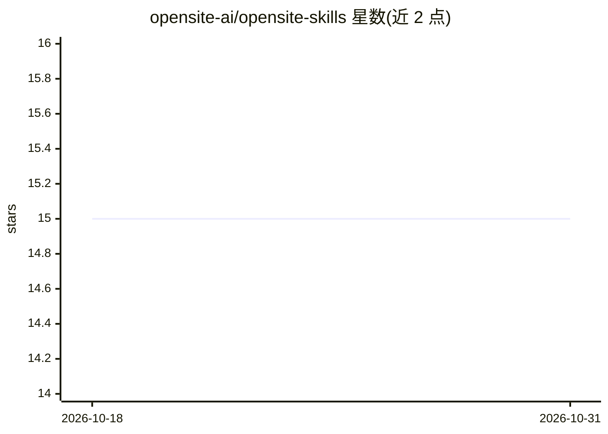

# opensite-ai/opensite-skills

⭐ 15 · Python · 推送 2026-10-19 · [GitHub](https://github.com/opensite-ai/opensite-skills) · [官网](https://opensite.ai) · 组织维护

**跨 AI 编码 agent 的技能库：单一仓库同步技能并附带持久记忆**

由 OpenSite AI 维护的 Agent Skills 开放标准技能库，覆盖前端设计、Rust/Rails 后端、AI/RAG 管道、数据库性能、DevOps 自动化及 AWS 官方技能集。核心机制是 setup.sh 通过符号链接将各平台技能目录指向同一仓库，使 Claude Code、Codex、Copilot、Cursor、Perplexity 等工具共享同一技能源。另含四个基于本地文件系统与 Python 3.8+ 的记忆技能（分层存储、相似度去重），以及基于 SQLite FTS5/BM25 的上下文压缩与检索技能，零外部依赖，数据仅存本地。

## 筛选速览

| 维度 | 判定 | 备注 |
|---|---|---|
| AI 角色 | `ai-ecosystem` | LLM/agent 周边工具 |
| 许可风险 | `none` | — |
| 部署形态 | `library` | 以包/库形式分发 |
| 模型依赖 | — | README 未给出锁定关系 |
| 硬件要求 | — | 无带数字的原话,不猜 |
| 安装摩擦 | `medium` | 含编译或系统依赖之一 |
| 成熟度 | — | 结构信号不足 |

## 能力要点

- setup.sh 检测已装平台并以符号链接统一各工具技能目录
- 四个记忆技能实现跨会话持久记忆（情景/语义/程序/工作四层）
- 上下文管理技能：SQLite FTS5 索引、BM25 检索、确定性压缩、会话检查点
- 兼容 Claude Code、Codex、Copilot、Cursor、Perplexity 等 10+ 平台

## 适用场景

- 同时在多个 AI 编码 agent 间维护一份同步的技能集
- 让编码 agent 在会话间保留项目知识与上下文
- 压缩大体积工具输出以延长上下文窗口

## 场景标签

`Agent 记忆` · 领域:Agent 开发

## 证据(README 行号)

> L7: A growing collection of skills spanning frontend design, Rust and Rails backend engineering, AI/RAG pipeline pattern
> L9: These skills follow the Agent Skills open standard and are compatible with:
> L37: ```bash

## 星数曲线



2026-10-18 15 → 2026-10-31 15（+0）


---
*卡片 v1 · prompt 1.4 · 生成 2026-10-30 · 置信度 mid · 依据 README sha `509a34a738cb` · [字段定义](../../DATASET.md)*
