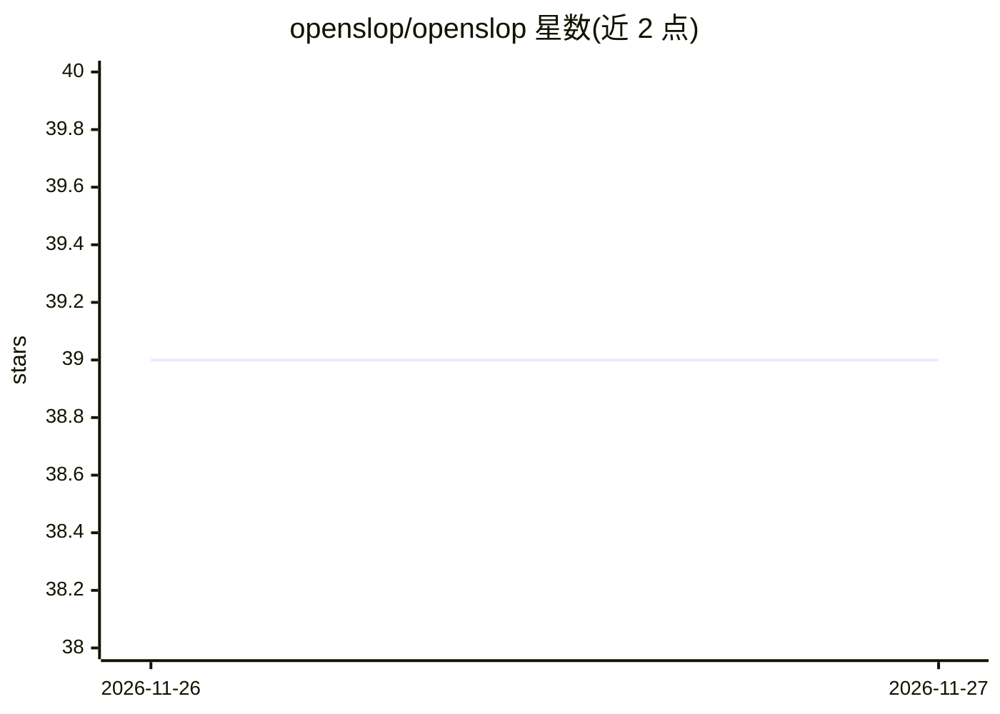

# openslop/openslop

⭐ 39 · TypeScript · Apache-2.0 · 推送 2026-11-26 · [GitHub](https://github.com/openslop/openslop) · [官网](https://openslop.ai) · 组织维护 · 中文 README

**对话式 AI 视频制作工作室：从提示到成片一条工作流**

开源的 AI 内容生产工作室，将多个 AI 工具接入统一工作流，用户通过对话与分镜画布生成视频、有声书等内容。核心机制：左侧 copilot 读取脚本、写场景；每个场景由语音/图像/视频/声音/音乐卡片堆叠组成，可逐卡选模型并重排；Generate all 按依赖顺序排队生成并标记过期卡片；带四轨时间线播放器、逐词字幕、Remotion Lambda 并行渲染导出 4K MP4。支持在线（邀请制 private beta）与本地模式（npm run local）两种运行方式，provider key 未设置时回落到 mock 结果。

## 筛选速览

| 维度 | 判定 | 备注 |
|---|---|---|
| AI 角色 | `ai-native` | 本体是模型或模型工具 |
| 许可风险 | `permissive` | Apache-2.0 |
| 部署形态 | `None` |  |
| 模型依赖 | — | README 未给出锁定关系 |
| 硬件要求 | — | 无带数字的原话,不猜 |
| 安装摩擦 | `low` | 无编译、无系统依赖或容器化 |
| 成熟度 | `idea` | |

## 能力要点

- Copilot 读取脚本并逐场景写作，结果实时落在画布
- 场景卡片模型可逐卡选择，生成按依赖图排队并标注 Stale 原因
- Bring your own keys：Anthropic/Runware/Cartesia/ElevenLabs key 存于 Supabase Vault
- Remotion Lambda 并行渲染导出最高 4K MP4

## 适用场景

- 从一句话描述生成短片或纪录片草片
- 制作有声书、Sleep Story 等 DIY 音视频内容
- 在本地电脑上运行、项目数据保存在自己机器

## 场景标签

`图像生成` `语音合成` `视频生成` · 领域:内容生成

## 证据(README 行号)

> L4:  The open-source AI production studio. Chat your way to finished films, shows, audiobooks, YouTube videos, documenta
> L30: OpenSlop wires all your favorite AI tools into one workflow so you can make good-looking video in minutes, no more 
> L87: Hosted models come with your account. Paste a key for Anthropic, Runware, Cartesia, or ElevenLabs and their models 

## 星数曲线

2026-11-26 39 → 2026-11-27 39（+0）

---
*卡片 v1 · prompt 1.4 · 生成 2026-11-26 · 置信度 high · 依据 README sha `10488e3061a3` · [字段定义](../../DATASET.md)*
