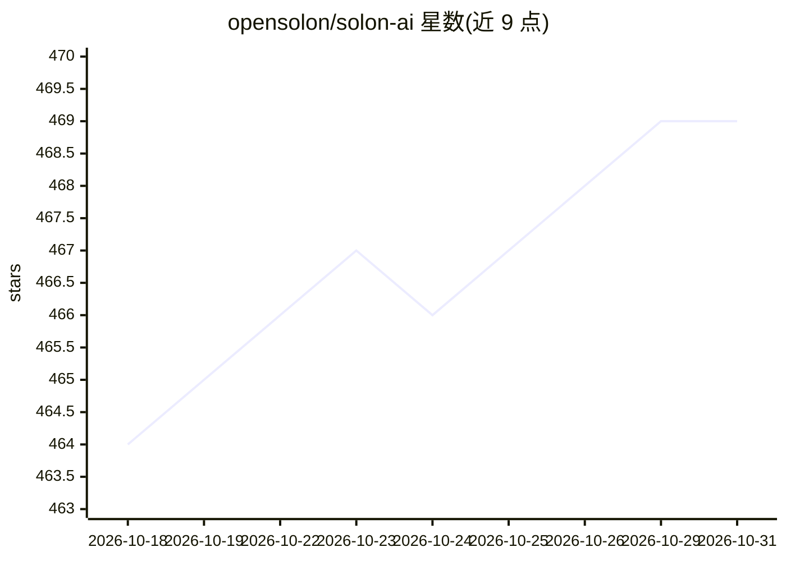

# opensolon/solon-ai

⭐ 469 · Java · Apache-2.0 · 推送 2026-10-26 · [GitHub](https://github.com/opensolon/solon-ai) · [官网](https://solon.noear.org) · 组织维护 · 中文 README

**面向 Java 开发者的 LLM/RAG/MCP/Agent 应用开发框架**

Solon 项目核心子项目，Java 全场景 AI 开发框架，提供 ChatModel 统一 LLM 调用接口（同步与 Reactive，多模型方言适配：OpenAI、Gemini、Claude、Ollama、DeepSeek、Dashscope）、RAG 全链路组件（DocumentLoader/Splitter/Embedding/Reranking）、MCP 协议服务端与客户端（MCP_2025_06_18）、ReAct 与 Team 多智能体编排及 YAML 流程编排 Ai Flow。兼容 JDK 8-25，可嵌入 SpringBoot、Vert.X、Quarkus 等框架。以 Maven 依赖形式提供。

## 筛选速览

| 维度 | 判定 | 备注 |
|---|---|---|
| AI 角色 | `ai-ecosystem` | LLM/agent 周边工具 |
| 许可风险 | `permissive` | Apache-2.0 |
| 部署形态 | `None` |  |
| 模型依赖 | local-ok | 支持本地模型 |
| 硬件要求 | — | 无带数字的原话,不猜 |
| 安装摩擦 | `medium` | 含编译或系统依赖之一 |
| 成熟度 | — | 结构信号不足 |

## 能力要点

- ChatModel 统一接口经方言适配多家模型厂商
- RAG 全链路组件与 RerankingModel 支持
- MCP 服务端与客户端（含 STREAMABLE 通道）
- ReActAgent 反思推理与 TeamAgent 多智能体协作（6 种预设协议）

## 适用场景

- 用 Java 构建接入 LLM 的生产级 AI 应用
- 搭建带知识库与重排序的 RAG 问答系统
- 开发 MCP 工具服务端或作为 MCP 客户端接入
- 编排 ReAct/Team 多智能体协作流程

## 场景标签

`RAG` `多智能体` `Agent 框架` · 领域:Agent 开发

## 证据(README 行号)

> L52: Solon AI is one of the core subprojects of the Solon project. It is a full-scenario Java AI development framework, 
> L176: Solon AI is a full-scenario Java AI development framework that deeply integrates LLM large models, RAG knowledge b

## 星数曲线

2026-10-18 464 → 2026-10-31 469（+5）

---
*卡片 v1 · prompt 1.4 · 生成 2026-10-21 · 置信度 high · 依据 README sha `c479628ff658` · [字段定义](../../DATASET.md)*
