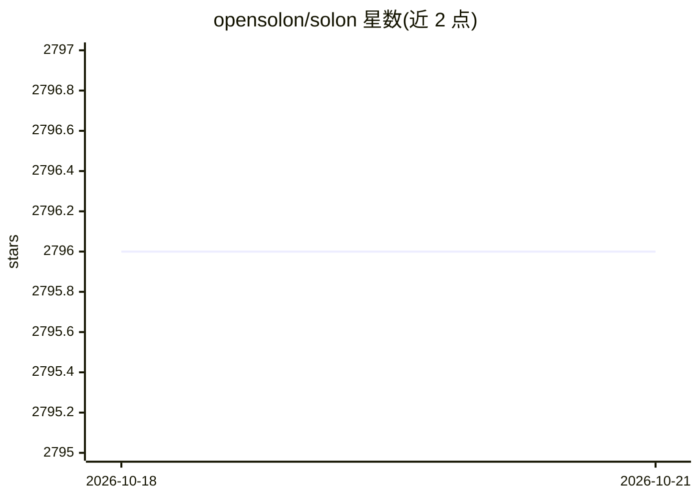

# opensolon/solon

⭐ 2,796 · Java · Apache-2.0 · 推送 2026-10-16 · [GitHub](https://github.com/opensolon/solon) · [官网](https://solon.noear.org) · 组织维护 · 中文 README

**Java 企业应用开发框架，含 AI 与 MCP 相关子生态**

从零构建的 Java 企业级应用开发框架，非 Java-EE/Servlet 架构，支持 java8~java26 与 GraalVM native image；采用 Maven/Gradle 构建生态，提供官方示例、单测与 IDE 插件（IDEA/VSCode）。生态含多个子仓库：solon-ai（AI 代码仓库）、solon-flow、solon-cloud、solon-admin 等，另有 Java8 版 Claude Code 实现 soloncode 与 OpenClaw 实现 solonclaw。许可证为 Apache 2。面向 Java 后端与微服务开发者。

## 筛选速览

| 维度 | 判定 | 备注 |
|---|---|---|
| AI 角色 | `ai-ecosystem` | LLM/agent 周边工具 |
| 许可风险 | `permissive` | Apache-2.0 |
| 部署形态 | `None` |  |
| 模型依赖 | — | README 未给出锁定关系 |
| 硬件要求 | — | 无带数字的原话,不猜 |
| 安装摩擦 | `medium` | 含编译或系统依赖之一 |
| 成熟度 | — | 结构信号不足 |

## 能力要点

- 非 Java-EE 架构，支持 java8~java26 与 GraalVM native image
- 多子仓库生态：solon-ai / solon-flow / solon-cloud / solon-admin 等
- 提供 Maven/Gradle 插件与 IDEA/VSCode 插件
- 含 soloncode（Java8 版 Claude Code）与 solonclaw（Java8 版 OpenClaw）实现

## 适用场景

- 用轻量框架开发 Java 企业应用与微服务
- 基于 solon-ai 子项目接入 AI/MCP 能力
- 在 Java8 环境下使用类 Claude Code 的工具

## 场景标签

`编码 Agent` · 领域:编码与开发

## 证据(README 行号)

> L3:  Java enterprise application development framework for full scenario
> L68: |/opensolon/solon-ai|Solon Ai ,Code repository|

## 星数曲线

2026-10-18 2,796 → 2026-10-21 2,796（+0）

---
*卡片 v1 · prompt 1.4 · 生成 2026-10-21 · 置信度 high · 依据 README sha `207558a33442` · [字段定义](../../DATASET.md)*
