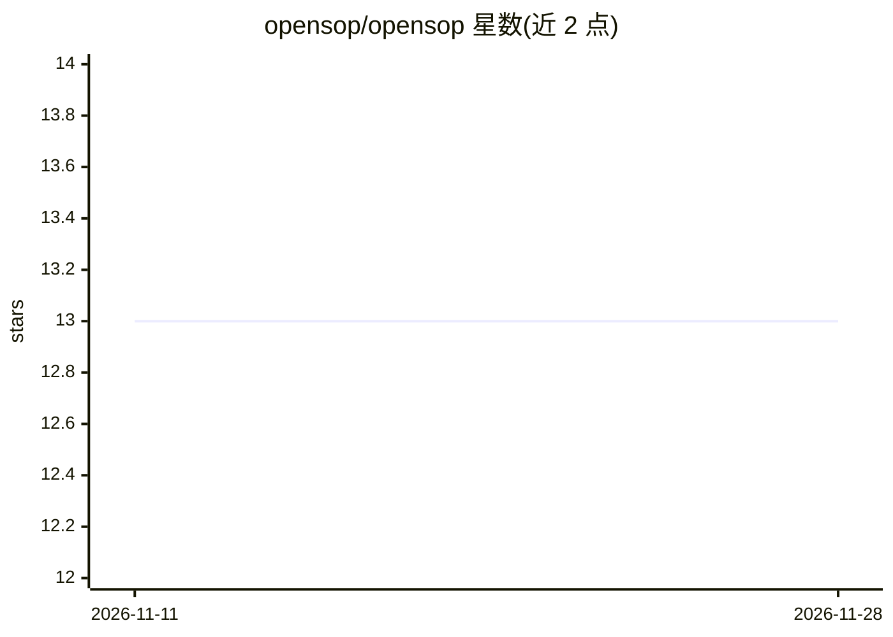

# opensop/opensop

⭐ 13 · Shell · Apache-2.0 · 推送 2026-11-11 · [GitHub](https://github.com/opensop/opensop) · [官网](https://opensop.ai) · 个人维护

**把 agent 工作流写成可执行文件的开源 CLI**

OpenSOP 提供一个单文件 bash CLI，将 agent 工作流写成 .sop.json 文件，每个步骤可以是脚本、LLM 调用或人工审批等形式。运行状态存于 run 文件夹（manifest、append-only 审计日志、context），任何厂商的 agent 或人都能读取并接续。llm/judgment 步骤经 schema 校验，可经 Claude Code/codex/cursor/kimi CLI 或 Anthropic API 调用，低置信度判断升级为人工。需 bash 4+ 与 jq，无服务器可选本地运行，服务器按规范契约自建。

## 筛选速览

| 维度 | 判定 | 备注 |
|---|---|---|
| AI 角色 | `ai-ecosystem` | LLM/agent 周边工具 |
| 许可风险 | `permissive` | Apache-2.0 |
| 部署形态 | `self-host` | docker 或自建部署 |
| 模型依赖 | locked-api |  |
| 硬件要求 | — | 无带数字的原话,不猜 |
| 安装摩擦 | `low` | 无编译、无系统依赖或容器化 |
| 成熟度 | `idea` | |

## 能力要点

- 10 种步骤类型（脚本、LLM、判断、循环、审批、webhook 等）可按文件逐级配置
- run 文件夹含 append-only audit.jsonl，每次调用记录 provider、模型、权限与 token 用量
- OSL_LLM_STUB 可在无 API key 情况下试运行 llm/judgment 步骤
- 通过 opensop skill install 为 claude/codex/hermes/openclaw/openhands/goose 等运行时装技能

## 适用场景

- 把固定流程做成文件在多个编码 agent 之间编排计划、构建、评审、测试与合并
- 让评审 agent 与作者 agent 来自不同厂商以交叉检查变更
- 团队需要可审计的 agent 运行记录并支持人工审批节点

## 场景标签

`工作流自动化` · 领域:效率与自动化

## 证据(README 行号)

> L11: OpenSOP lets you set that dial step by step, in one simple file. **Scripts where it must be certain, LLMs where it 
> L43: `model` picks the vendor. `claude-code:`, `codex:`, `cursor:` and `kimi:` drive those CLIs non-interactively (empty
> L71: OpenSOP is built to be driven by agents. Every command speaks `--json`, `opensop status` says what a run is waiting

## 星数曲线

2026-11-11 13 → 2026-11-28 13（+0）

---
*卡片 v1 · prompt 1.4 · 生成 2026-11-18 · 置信度 mid · 依据 README sha `a52cc4045f53` · [字段定义](../../DATASET.md)*
